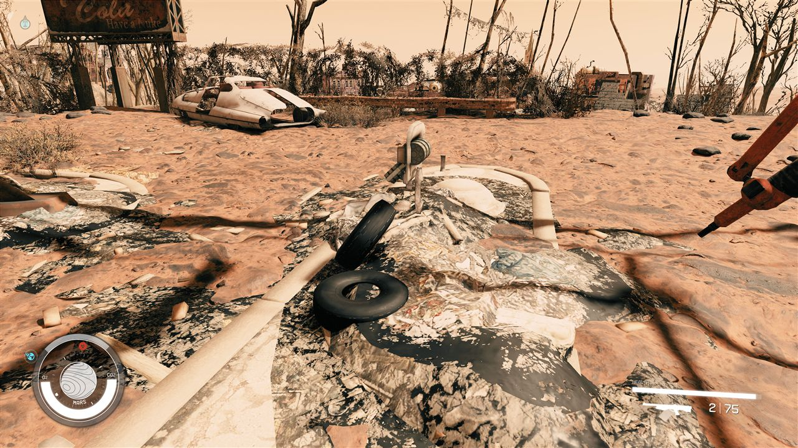
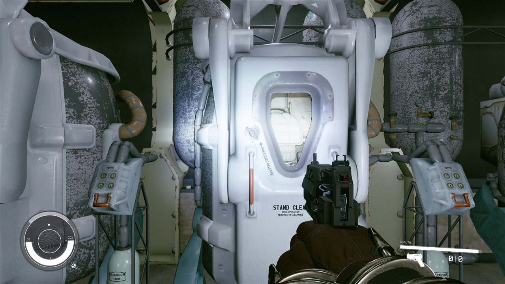

# Fallout 4 → Starfield: a measured conversion toolchain

**Bring Fallout 4 into Starfield's Creation Engine 2 through a measured, repeatable conversion toolchain.** The goal is to preserve Fallout 4 gameplay while using Starfield's native physics and modern engine capabilities. Experimental interiors already load in Starfield; the full game conversion is unfinished.

**Not offered for download or play for now.** On 19 Oct the owner withdrew the play and install guides, for legal reasons and so nobody's hopes are raised early; a letter asking Bethesda about the project went out the same day, and the repository is to be made private. This page records progress only.

Reviewing or forking with an AI assistant? Point it at [docs/ai/for-ai-reviewers.md](docs/ai/for-ai-reviewers.md) first.

Converters read **your own copies of both games** and generate local outputs. No game files or conversion pack are distributed. Existing in-game screenshots depict Bethesda-owned visuals and are excluded from the project's code license.

[Latest progress](#latest-progress--2026-10-20) · [Roadmap](docs/ROADMAP.md) · [Progress dashboard](https://claude.ai/artifact/SjY6rgmjtdmN8ryjxAUxAp) · [Live updates](https://github.com/fo4sf/fo4-to-starfield/issues/32) · [Contribute](CONTRIBUTING.md)

## Latest progress — 2026-10-20

**Priority from here on (owner, 19 Oct): the combined core comes first.** This is a GAMMA-style second way to play, built around settlements that grow, factions that act and a connected wasteland, starting on the Commonwealth. It has value without the open legal questions. The stories are still wanted, and the work already in flight continues. The owner's decisions for every phase are in [docs/research/framework/dependencies.md on #408](https://github.com/fo4sf/fo4-to-starfield/pull/408) and are not repeated here.

| Work | State on 20 Oct | Where |
|---|---|---|
| **v6e crash test** | in progress on the owner's PC: the Red Rocket and museum build with the side-door rig off and the movable props static; the next build in the bisect waits on its result | #375 (merged), #400 |
| **Mission** | the cut-down "When Freedom Calls" ran to completion in game on v6c; the Preston fix is in the v6e build | #353 |
| **Map markers** | the runtime mover is merged; an installer and every Commonwealth marker are staged, and a merge probe is staged; none is installed yet | #376 (merged), #399 |
| **All interiors** | 271 interiors in 9 staged batches; batches 2 to 4 (104 interiors) passed their build checks on the PC; batch 5 is queued; not installed | #396 |
| **Vault 111 start** (phase 1) | the cryo-pod start in converted Vault 111 and a quest engine probe are built and staged offline; the first test needs a new game after v6e | #393 |
| **Door animations** (phase 2) | load doors that open before the trip, behind a switch that is off by default | #392 |
| **Launcher backbone** (phase 4) | build manifest, resumable build, recorded restore and a same-ids check; CI green, waiting on Codex | #394 |
| **Engine mechanics reference** | Fallout 4 against Starfield, mechanism by mechanism | #404 |
| **Next-phase framework** | the questions, dependencies and decisions for every later phase, including the combined core's design and offline prototype | #408 |
| **Test tooling** | night-chain arm check, preflight report, tiered queues, door trips per interior batch | #391, #397, #403, #405 |

All of these are offline or staged builds. Nothing new is installed until the v6e test is done.

Progress on 19 October

### 2026-10-19

**The first mission runs in game, and the build that carries it is under a crash bisect.** Nothing new is deployed until that test is done. Dates are UTC unless marked.

| Area | State on 19 Oct | Evidence |
|---|---|---|
| **Installed on the test PC** | core `terrain_core64v6c_l125_mission_wfc9b` with port `integ_v6_specmask_doors_c`; the earlier v5 set is the rollback | install record on the PC; mission notes on #353 (2c2ef2b) |
| **Mission** | a cut-down "When Freedom Calls" ran to completion in game: stages 20, 30 (5 of 5 raiders dead), 40, 200 and complete. Preston targeted the player twice; the faction fix (wfc10) is built but untested | [docs/mission/when-freedom-calls.md on #353](https://github.com/fo4sf/fo4-to-starfield/blob/2c2ef2bd7fc896bdff0996bf943bfb624f5c6c5b/docs/mission/when-freedom-calls.md), PR #353 |
| **Codsworth** | a robot stand-in at his Sanctuary spot; 20 of his Fallout 4 voice lines have been converted from the owner's own files so far, and the in-game voice check is open | #361 (merged, 4492d13) |
| **Crashes near Red Rocket and the museum** | three crashes on v6, two of them seconds after the museum fight; crashes persisted with the two nearby map markers disabled, and the cause remains unresolved. Within 300 m of Red Rocket v6c added 404 movable props and 12 door changes, so a test build with the side-door rig off and those props static (v6e) is staged, not installed | #375 (bisect switches and `near_changes.py`, merged 19 Oct), #353 notes |
| **Map** | the four markers (Red Rocket, Sanctuary, Vault 111, Concord) are enabled but draw no icon on v6. Supported hypothesis: persistent references stay at their local position, so #376 (merged 19 Oct) moves them at run time; a one-reference merge probe compares add-on and vanilla persistent-reference positions in the same session to narrow the writer-side cause | #376 |
| **Passed in game so far** | the mission (above); the Super Duper Mart and Boston Public Library load doors both ways; most indoor pickups; 19 of 20 library stair routes (the 20th never started); the Red Rocket to Sanctuary walk on core64c (before v6) | test records of 17 and 18 Oct, summarised on [#32](https://github.com/fo4sf/fo4-to-starfield/issues/32) |
| **Still open** | about 190 interiors unconverted; no Pip-Boy; lights, distant LOD, textures, carrying objects (the 18 Oct movable tests read FAIL or INCONCLUSIVE) | [docs/owner/playtest-issues.md](docs/owner/playtest-issues.md) |

**Next, approved by the owner on 19 Oct** (order: new game first, then doors, then interiors, then the launcher): a Vault 111 new-game start with no Starfield intro; load doors with enter and exit animations; all interiors converted in batches; then a launcher that ships no assets and builds the port from the player's own Fallout 4. Offline work on all four started on 19 Oct as draft PRs (#393, #392, #396, #394; listed in the roadmap); the research notes are in draft PR #380 and the proposals from Grok and Codex in #381 and #382.

Progress on 17 October

### 2026-10-17

**The whole playable Commonwealth exterior and 16 interiors run natively in Starfield, and the owner is playtesting them.** Dates are Mountain time. The live list of what the owner found and what was done about it is [docs/owner/playtest-issues.md](docs/owner/playtest-issues.md) (26 rows with screenshots); the checks the owner runs are in [docs/owner/in-game-test-sheet.md](docs/owner/in-game-test-sheet.md); what comes after this testing is in [docs/ROADMAP.md](docs/ROADMAP.md).

| Area | State on 17 Oct | Evidence |
|---|---|---|
| **Exterior** | the 64 x 64 cell core as native terrain with 648,358 placed objects (build `core64k`); the owner walked from Red Rocket to the Diamond City gate with no crash and no boundary | playtest row 25; walk gates PASS |
| **Objects as records** | 5,185 containers, 12,438 loose items, activators, terminals, 6,249 lights, 29 workshops, 269 crafting benches on Starfield's stations; owner-verified: pickup, containers, the scanner, the Red Rocket workshop's build mode. Not yet checked: the other workshops, the bench menus, the terminals; activators show a prompt but are not wired yet | playtest rows 12, 16, 21 |
| **Interiors** | 16 reachable by `coc` (build `integ_1018`): Vault 111's sliding doors work (the cog door is still a solid static), posed props, crash-fixed collision | owner-verified 17 Oct; the shooting crash's cause came from the owner's crash dump (#274) |
| **Doors between them** | the exterior Super Duper Mart door is a scripted door: entering works when the runner activates it from the console (16 Oct); the way back is written (#291, #297) and its runner test is staged | docs/terrain/scripted-doors.md |
| **Actors** | a converted raider fights the player once combat is forced from the console; a vanilla NPC paths on the converted navmesh | npc_combat, npc_nav queues |
| **Open** | lights far too bright at night (calibration 2.3x vanilla; a dimmed build staged, #302), nothing visible beyond the loaded cells (no distant LOD yet), a passable gate and a plank over water in Vault 111 (fixes in review), carrying objects, the garage button (#303), textures (Grok's passes), map and fast travel | playtest rows 19-26 |

Earlier progress (14-15 October)

### 2026-10-15

**October 14 recap: worldspace launches work again, and the observation bridge reads player position directly from the game.** Dates here use Mountain time; some evening commits appear as October 15 in UTC.

- **Claude fixed the load-order dialog and verified it in two launches.** The runner selects **Current**, checks that experiment plugins remain active, and stops if activation changes. Converted worldspaces loaded again, and all 18 terrain probes ran in daylight. The terrain verdicts remained inconclusive because of an OCR error and a misplaced landing; this is not ground-texture acceptance. [Verified run and captures](https://github.com/fo4sf/fo4-to-starfield/issues/32#issuecomment-6165570079).
- **The new observation bridge worked in an eight-minute in-game session.** It recorded 473 log lines with player position, heading and cell/world IDs. A two-second walk measured 1.64 m; the bridge's timer/state survived save/load. This verifies the telemetry bridge, not converted-game persistence. The runner then gained log-based player reads, reducing its dependence on console OCR; object-reference reads still need separate checks. [Session record](https://github.com/fo4sf/fo4-to-starfield/commit/32a5f5b61fa12b9401fb75f2deb4659cb840af90).
- **Codex and Grok tightened evidence handling.** Codex added Windows protection against archive changes during fingerprinting; Grok corrected terrain-evidence aliases and malformed-number handling. These are offline correctness improvements, with current merge/review status below.

**October 15 follow-up:** Claude reports the Sanctuary–Red Rocket walk passed in both directions on build `2470f876` + core64c, about 254 m each way, using bridge position reads. Independent native acceptance remains open. The cave door still does not load: its persistent reference reports an unmerged position, and the first proposed fix was refuted. A probe-bearing exterior-cell override also displaced the spawn, so that construction needs redesign. [Pinned walk journal](https://github.com/fo4sf/fo4-to-starfield/blob/10e7019be4e97ce8976b1f0eeb164ecb8d19b04b/docs/JOURNAL.md#L1139), [cave A/B results](https://github.com/fo4sf/fo4-to-starfield/issues/32#issuecomment-6187749682).

The consolidated runner is now on `main` through [integration #121](https://github.com/fo4sf/fo4-to-starfield/pull/121). Its individual features and unfinished acceptance gates are distinct:

| Work | Evidence and current limit |
|---|---|
| **Interiors, materials and native collision** | Vault 111, Vault 81, Red Rocket cave, Vault 114, Prydwen, Hotel Rexford, Boston Public Library and Parsons load in experimental builds. Stairs and hinged doors have recorded in-game passes; the complete interior acceptance gate remains open. |
| **Commonwealth terrain and structures** | Core64c stages 648,358 references in 1,708 populated cells across a 6.4 km extent. That is placement coverage, not tested map coverage or an engine-size guarantee. Earlier campaigns recorded 7/7 smoke, 29/30 nearby and 15/15 informational sampled height matches. The northeast +1.8939 m mismatch and four old jumps in the wrong coordinate frame remain preserved. [Completed informational run](https://github.com/fo4sf/fo4-to-starfield/issues/32#issuecomment-6154661951). |
| **Connected walking and cave** | Both-direction walking is lead-reported in-game; the cave transition remains blocked. Correct entry/exit, facing, door/frame collision and save/reload are still required before accepting the connected slice. |
| **Independent evidence checks** | The original [read-only checker](docs/testing/commonwealth-evidence.md) and [Windows archive guard, #120](https://github.com/fo4sf/fo4-to-starfield/pull/120), are merged. Codex's draft, unmerged [door/walk audit, #118](https://github.com/fo4sf/fo4-to-starfield/pull/118), passes a 414-test Windows suite (3 skips), independent QA and CI; native adapter proof is pending. Grok's [terrain oracle, #69](https://github.com/fo4sf/fo4-to-starfield/pull/69), passes 21 author tests and 14 independent controls; merge is pending. Neither review establishes native acceptance. |
| **Recoverable deployment** | Experiment recovery is on `main`. Codex's additional [bridge recovery fix, #125](https://github.com/fo4sf/fo4-to-starfield/pull/125), retains interrupted/ambiguous ownership and passes 43 focused tests, a 1,301-test Windows suite (70 skips), independent QA and CI. It is ready for integration, not deployed. [Configuration-race work, #104](https://github.com/fo4sf/fo4-to-starfield/pull/104), also remains proposed. |
| **NPC navigation and combat** | The test harness now reads combat state, target and line of sight. A vanilla hostile engaged in one attempt but not another; the converted raider did not engage or move. A forced-engagement control is planned before judging the conversion. [Native observations](https://github.com/fo4sf/fo4-to-starfield/issues/32#issuecomment-6187749682). |

The full interior queue, movable-object replanning, cave connection and broader world streaming remain unfinished. A fresh checkout of `main` does not install game assets or reproduce an experimental build automatically.
Follow [the shared update thread](https://github.com/fo4sf/fo4-to-starfield/issues/32) for exact revisions, results and corrections.

### Recent in-game route results

Earlier results reported by Claude on 2026-10-10 for one pinned test build (code `1d3d5bf`; details and limitations in [shared status #32](https://github.com/fo4sf/fo4-to-starfield/issues/32)). These are separate from the newer integration batch above:

| Test area | Result |
|---|---|
| Vault 111 | 12/12 routes passed, including stairs and a switch door from both sides |
| Parsons | 11 hinged doors passed from both sides with an `OPEN` prompt recorded |
| Vault 114 | 28 routes passed; three doors still failed on both sides and three passed on one side only |
| Hotel Rexford | 28 routes passed; one door failed on both sides and three passed on one side only |
| Prydwen | Partial run: 11 passes, 7 falls, and 14 unread results among 33 reported attempts (one attempt is unclassified in the status summary) |
| Vault 81 and Boston Public Library | Not yet run on that pinned route build |

These are reports for a particular build, not a guarantee about other builds or a finished conversion. Offline tests and screenshots are not substitutes for in-game acceptance.

### See the work

**Red Rocket after the Sanctuary walk — October 15 follow-up.** Claude's capture from the experimental core64c route; appearance and connected-cave acceptance remain unfinished.

**Vault 111 during the October 14 observation-bridge session.** The bridge measurements are recorded in the linked session log above; the screenshot illustrates the scene.

**Hotel Rexford: native hinged door**

**Parsons: both-side door evidence**

[Opposite-side capture](docs/media/route-parsons-door-bothsides-b.jpg) · [First textured chair](docs/media/fo4-chair-textured-in-starfield.png) · [Vault 111 stairs](docs/media/vault111-stairs-catwalk-in-starfield.png)

More captured work: [Vault 111](docs/spikes/WP10-vault111-first-light.md) · [additional interiors](docs/spikes/WP10-more-interiors.md) · [collision](docs/spikes/S6-collision.md) · [door routes and test evidence](https://github.com/fo4sf/fo4-to-starfield/issues/32).

## What remains

The next goals are in [docs/ROADMAP.md](docs/ROADMAP.md). First the current v6e crash test finishes. The combined core comes first from here on; the approved single-game phases continue in the owner's order of 19 Oct: a Vault 111 new-game start, load doors with enter and exit animations, all interiors, and a launcher that builds from the player's own games. The interior slice still needs reliable stairs, clear openings, both-side door operation, pushable objects and repeatable deployment. Some route failures come from test positioning; others require geometry or physics fixes. Nearby terrain has sampled evidence and continuous walking has lead-reported passes; the cave connection, independent acceptance, larger regional streaming and actor behavior remain open. Quests, dialogue, combat systems and full-game parity are unfinished. See [the issue tracker](https://github.com/fo4sf/fo4-to-starfield/issues) and [risk register](docs/RISKS.md).

## Why conversion is difficult

| Format area | Fallout 4 | Starfield |
|---|---|---|
| Plugin form version | 131 | 581 |
| Shared record fields | Sampled overlap is mostly 25–60% | Different record model and fields |
| Terrain | 37,020 `LAND` records in the measured sample | `.btd` terrain and procedural planets |
| Meshes | NIF geometry | NIF metadata plus external `.mesh` geometry |
| Materials | `.bgsm` / `.bgem` | JSON `.mat`, compiled into `.cdb` |
| Collision | Havok 2014 packfile | Havok tagfile and `hknp` shapes |

These are measured research notes, not promises of complete format support. Methods and sources: [format gap](docs/FORMAT-GAP.md), [spikes](docs/spikes/), and [measurement scripts](scripts/).

## Safety and project rules

- **No raw game assets or extracted files in Git or releases.** Do not submit `.esm`, `.ba2`, `.nif`, `.dds`, `.mesh`, `.hkx`, audio, executables, or converted outputs. The repository currently includes a limited set of screenshots captured in-game; these depict third-party visuals, are excluded from the MIT grant, and do not establish permission for reuse. The guard and CI check for raw assets and local paths.
- Converters read local files selected by the user; generated outputs stay local. The project does not distribute a conversion pack.
- Tests use synthetic fixtures. Offline passes do not prove that an asset works in-game.
- This is for offline, single-player modding research. It does not modify either game's executable.
- Do not commit credentials, personal machine paths, or private game data. Report suspected vulnerabilities using [GitHub's private reporting option](https://github.com/fo4sf/fo4-to-starfield/security/advisories/new) when available; see [SECURITY.md](SECURITY.md).

## Legal and license

This repository is unofficial and is not affiliated with or endorsed by Bethesda Softworks or ZeniMax Media. Fallout, Starfield, Creation Engine, and related names and materials belong to their respective owners. **The MIT license in this repository applies only to original project code and documentation; it does not grant rights to Bethesda software, game assets, trademarks, screenshots, or user-generated outputs.**

The project does not provide legal advice or establish that any particular extraction, conversion, or use is permitted. Check the current [Bethesda Terms of Service](https://bethesda.net/data/tos/en.html), the applicable [game EULA](https://bethesda.net/data/eula/en.html), and laws where you live; seek qualified legal advice if you need a determination for your circumstances. Avoid uploading or sharing game-derived outputs unless you have confirmed you have the necessary rights.

## Contributing and attribution

Read [CONTRIBUTING.md](CONTRIBUTING.md), choose an open issue, and use its acceptance criteria. Every change must pass the synthetic tests and asset guard. Identify whether a result is **in-game verified**, **offline tested**, or an **unverified hypothesis**.

The project is led by the repository owner. AI-assisted contributions are acknowledged by role: **Claude** (conversion pipeline and in-game testing), **Codex** (deployment, recovery, persistent identities, and output verification), and **Grok** (acceptance criteria and evidence gates). Agent labels and commit subjects identify work; these names do not represent separate human contributors or endorsements.
