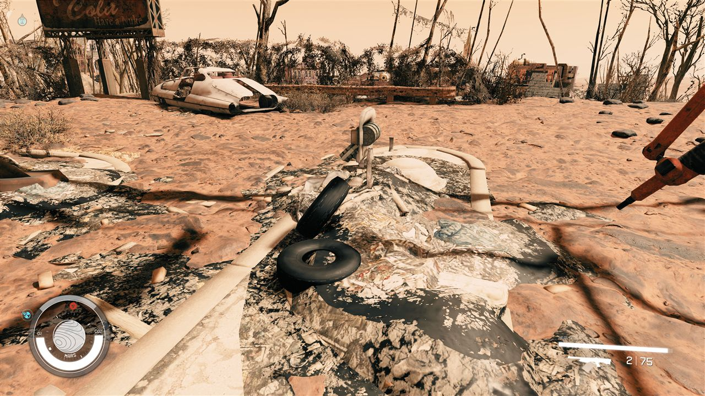
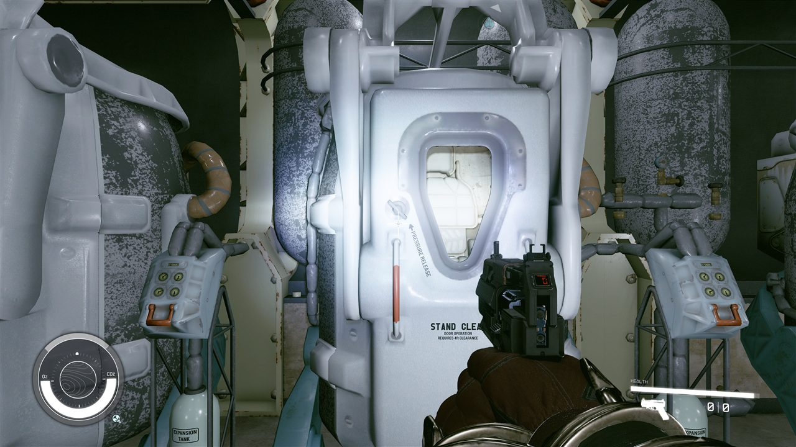

# Fallout 4 → Starfield

**A Commonwealth-first Fallout experience and total-conversion framework for Starfield.** The toolchain reads the
player's own game files and rebuilds terrain, buildings, interiors, doors, objects and supported actors and scripts
as Creation Engine 2 data. An exterior test world, selected interiors, a reduced mission and a Vault 111 new-game
start have run on the owner's test PC. The broader goal is a GAMMA-style living world with survival and warfare
modes, settlements and factions, with other Fallout regions added later. The conversion and the living-world core
are unfinished; their current evidence and remaining gates are listed below.

**Public research repository; no playable release or conversion pack is offered.** Generated game content stays on
the player's PC and requires their own installs. In-game screenshots depict Bethesda-owned visuals and are excluded
from the project's code license.

Reviewing or forking with an AI assistant? Point it at [docs/ai/for-ai-reviewers.md](docs/ai/for-ai-reviewers.md) first.

[Where it stands](#where-it-stands-3-november-2026) · [Two ways to play](#two-ways-to-play) · [How it works](#how-it-works) ·
[Roadmap](docs/ROADMAP.md) · [Journal](docs/JOURNAL.md) · [Status thread #32](https://github.com/fo4sf/fo4-to-starfield/issues/32) ·
[Agent handoff](docs/CODEX-HANDOFF.md) · [Contribute](CONTRIBUTING.md)

## Where it stands (3 November 2026)

**Phase 0, the Commonwealth test slice, is done by the owner's word (24 October).** Its exit gates were ticked in
game: the mission's pull request merged after review; the automated door rounds passed (29 of 30 round-trip legs, 0
failures; the one non-pass was the border popup); with the border switch on, the Vault 95 exit landed and the owner
walked west and south of Red Rocket with no wall; and the owner's own hand checks of the mission, the map markers and
the doors were done. Since then the work has moved to the combined core (below)
and to the next phase of the single-game conversion. Every row here says whether it was seen in the game or only in
offline tests; dates are UTC.

| Area | State | Seen |
|---|---|---|
| **Commonwealth exterior** | the 64 × 64 cell core as native terrain with 648,358 placed objects; the owner walked from Red Rocket to the Diamond City gate with no crash and no boundary | in game, 17 Oct |
| **No walls** | an SFSE plugin (`FO4SFBorder`) switches Starfield's landing border off inside our world only; with it on the owner walked west and south of Red Rocket and hit no wall, and the first-load flicker that left the border on is fixed | in game, 24 Oct |
| **Interiors** | 16 interiors reached in game so far (Vault 111, Vault 81, the Red Rocket cave, Vault 114, the Prydwen, Hotel Rexford, the Boston Public Library, Parsons and more), with working stairs, hinged and sliding doors and posed props; 253 more (the 251 planned base-game interiors and Automatron's 2; 4 odd hook cells are left out) are built in batches and held for install | in game (16), offline (253 more) |
| **Load doors with animation** | load doors that open before the trip (`FO4SF_AnimatedLoadDoor`); the port carrying them is installed and its automated door rounds are queued | installed 28 Oct, rounds pending |
| **First mission** | a cut-down "When Freedom Calls" ran to completion: stages 20, 30 (5 of 5 raiders), 40, 200 and complete; this historical test does not establish full quest coverage | in game, 19 Oct |
| **Codsworth** | a robot stand-in at his Sanctuary spot, rendering with plain shader blocks (the fix that solved the Red Rocket crash); 20 of his voice lines converted from the owner's files; his spawn on an existing save is on the defect list | in game, 22 to 23 Oct |
| **Map markers** | one reload after marker placement and a dark hold through that reload are merged; the owner reported the 31 Oct test worked, with a remaining issue left for the Pip-Boy whose exact scope was not stated | in game, 31 Oct; [record](docs/terrain/map-markers.md) |
| **New game** | run 4, newgame_v12, reached the surface at stage 200; MQ101 was not running when checked and the owner reported it worked. Launcher start choices and the pre-war vault remain later work | in game, 31 Oct; [record](docs/newgame/vault111-start.md#13b-in-game-run-4-31-oct-2026-newgame_v12-pass-to-stage-200-our-own-start) |
| **Launcher** | checkout updating, recorded restore and a separate FO4SF game folder are on main. The follow-up that retains crash evidence when settings restoration fails is still under review in [#668](https://github.com/fo4sf/fo4-to-starfield/pull/668); source-version support remains tied to the checked source/runtime tables | merged machinery; follow-up reviewed offline |
| **Combined core, offline** | the 28 Oct Commonwealth seed contains 243 places, 42 settlements and 7 factions from 487 locations and all six DLC. The C++ port through C5 is written and has selected Windows byte-parity checks; [#649](https://github.com/fo4sf/fo4-to-starfield/pull/649), [#651–#654](https://github.com/fo4sf/fo4-to-starfield/pull/654) and the Windows build [#656](https://github.com/fo4sf/fo4-to-starfield/pull/656) remain in review | offline; not a game runtime |
| **Combined core, in game** | P2, P3's keyword half, P4, P6, P7, P8 and P10 passed their scoped probes, and P5 recorded timings. P3's cell half and a complete P1 sidecar verdict remain open | in game, 28 Oct; [probe record](docs/spikes/combined-core-probes.md) |
| **NPC travel** | Claude reports two loaded walks of 439 m across 7 cells, and an unloaded approach from a 643 m spawn that arrived after 796 s. Longer starts showed a jump or parking; these are route observations, not universal engine distances. Judge corrections remain open in [#663](https://github.com/fo4sf/fo4-to-starfield/pull/663#pullrequestreview-5733485009) and [#669](https://github.com/fo4sf/fo4-to-starfield/pull/669#pullrequestreview-5746648639) | reported in game, 2 Nov; [runs and corrections](https://github.com/fo4sf/fo4-to-starfield/issues/644) |
| **Own Fallout world** | the first planet probe loaded a planet from project records; persistent-reference placement and biome/location checks still need the next test. Reversible stripping and cross-game staging plans are drafts [#665](https://github.com/fo4sf/fo4-to-starfield/pull/665) and [#667](https://github.com/fo4sf/fo4-to-starfield/pull/667) | partial native probe; further staging pending |
| **Tests and CI** | fixture tests and the asset guard run in CI. Check each PR's exact head and review; selected offline or hosted passes do not establish a passing full Windows suite or native gameplay | [pull requests](https://github.com/fo4sf/fo4-to-starfield/pulls) |

Current work covers review of the C++ port, the engine gates before a 20-place living-world slice, the separate
Fallout world and launcher recovery. More start choices, Pip-Boy/map work and verified source-version support remain
on the roadmap. The full ledger, with evidence for every row, is [docs/ROADMAP.md](docs/ROADMAP.md); the day-by-day
record is [docs/JOURNAL.md](docs/JOURNAL.md); the owner's own findings are
[docs/owner/playtest-issues.md](docs/owner/playtest-issues.md). The front page's earlier progress tables are kept in
[docs/history/readme-progress-2026-10.md](docs/history/readme-progress-2026-10.md).

## Two ways to play

**Fallout 4 as itself.** The conversion carries Fallout 4's world and content into Starfield piece by piece: terrain
and placed objects, interiors with their doors and stairs, actors on a converted navmesh, the quests, starting with the
Vault 111 start and "When Freedom Calls". The approved phases, in the owner's order of 19 October: the new game, load
doors with enter and exit animations, all interiors, then a launcher that builds the port on the player's PC. All
Fallout 4 DLC are required; SFSE is required; nothing is shipped but code.

**The combined core.** A GAMMA-style second way to play, built like S.T.A.L.K.E.R. GAMMA on Anomaly: one curated
Fallout on Starfield's engine, for players who own the games. Its pillars are settlements that grow, factions that act
and hold territory, and a connected wasteland, with survival as one layer. The world runs offline as a deterministic
simulation seeded from the player's own Fallout 4 data (`src/fo4sf/combined/`), and the game shows what happens near
the player: squads, caravans, garrisons, radiant jobs, terminal and radio news. The owner's calls of 25 October shape
it: travel by corridors and a capped map pick, with vertibirds for long trips; two modes, Warfare (pick a faction and
one of its bases) and Survival (story on or off); after death in Warfare the player goes on as another member of the
faction; ghoul play; and no language model or online service anywhere in gameplay. Design:
[docs/combined-core.md](docs/combined-core.md); the C++ port plan:
[docs/combined-core-cpp-port.md](docs/combined-core-cpp-port.md); the in-game probes:
[docs/spikes/combined-core-probes.md](docs/spikes/combined-core-probes.md).

The broader framework is intended to support other authored or converted experiences in Starfield. Small support
backends may become standalone tools or mods when they can work independently; that is a release goal, not a current
Nexus download. Other Fallout regions and species-specific creature behaviour still need their own implementation
and acceptance tests.

## How it works

Starfield's executable cannot be rebuilt, so the project is a **total conversion on the stock executable**: Fallout 4's
data is converted into Starfield's formats and loaded as a plugin with loose files, with SFSE plugins where Papyrus
cannot reach. Fallout 4's own engine is not replaced; only its data is carried across. The method is in
[docs/PLAN.md](docs/PLAN.md); the risks and the spikes that answered them are in [docs/RISKS.md](docs/RISKS.md) and
[docs/spikes/](docs/spikes/).

| Stage | What runs | Where |
|---|---|---|
| **Read** | Fallout 4's plugins, archives, meshes, materials, collision, terrain and navmesh, read from the player's install | `src/fo4sf/` (`nif.py`, `ba2.py`, `fo4land.py`, `hkpackfile.py`, `navmesh.py`, …) |
| **Convert** | meshes to NIF metadata plus `.mesh` geometry, materials to `.mat`, Havok packfiles to tagfiles, FO4 land to an overlay worldspace on `.btd` terrain, navmeshes cut at Starfield's cell lines, doors re-rigged with their own clips | `src/fo4sf/`, `scripts/terrain/`, `scripts/slice/` |
| **Write records** | the Starfield plugins: the terrain core, the interiors port, map markers, the mission, the new game, the probes; built with Mutagen in .NET | `dotnet/` (`Fo4Export`, `Fo4Land`, `MapMarkers`, `CombinedProbe`, …) |
| **Script and hook** | Papyrus scripts for doors, the mission, the bridge and the probes; SFSE plugins for what Papyrus cannot do (the per-world border switch, the combined core's sidecar) | `scripts/bridge/`, `scripts/mission/`, `scripts/newgame/`, `sfse/` |
| **Stage, deploy, roll back** | every build is staged with pinned hashes and installed or removed as a unit on the test PC | `scripts/deploy_starfield.py`, `scripts/testing/` |
| **Test in game** | a runner on the test PC launches Starfield through SFSE, drives the console, reads the game's own log through the bridge and judges each test (door rounds, walks, terrain probes, the engine probes); the owner's hand checks follow the test sheet | `scripts/game/`, `src/fo4sf/combined/probes.py`, `docs/owner/in-game-test-sheet.md` |
| **Launch** | a desktop launcher that detects both games, fixes the load order and starts the game | `src/fo4sf/launcher/`, `scripts/launcher.py` |

Every claim in the docs is labelled **in-game verified**, **offline tested** or an **unverified hypothesis**, and the
journal is append-only: corrections are new entries, never edits. The guard (`scripts/guard.py`) fails any commit that
carries game data or a path from someone's machine.

## See the work

**Red Rocket at the end of the Sanctuary walk** (experimental core, 15 October).

**Vault 111 during an observation-bridge session** (14 October).

**Hotel Rexford: a native hinged door.**

**Parsons: the same door from both sides.**

[Opposite side](docs/media/route-parsons-door-bothsides-b.jpg) · [First textured chair](docs/media/fo4-chair-textured-in-starfield.png) ·
[Vault 111 stairs](docs/media/vault111-stairs-catwalk-in-starfield.png) · [Vault 111 first light](docs/spikes/WP10-vault111-first-light.md) ·
[More interiors](docs/spikes/WP10-more-interiors.md) · [Collision](docs/spikes/S6-collision.md) · [All captures](docs/media/)

## Repository map

| Folder | Holds |
|---|---|
| `src/fo4sf/` | the converters and format readers; `combined/` the combined core's model, simulation, seed and probe judges; `core/` the build-and-test orchestrator; `launcher/` the launcher |
| `scripts/` | build, stage, deploy and test tools: `terrain/`, `slice/`, `bridge/`, `mission/`, `newgame/`, `mapmarkers/`, `combined_probes/`, `game/` (the PC test runner), `guard.py` |
| `dotnet/` | the Mutagen-based plugin writers and in-game probes |
| `sfse/` | the SFSE plugins: `FO4SFBorder`, `FOCCSidecar` |
| `docs/` | [PLAN](docs/PLAN.md), [ROADMAP](docs/ROADMAP.md), [JOURNAL](docs/JOURNAL.md), [RISKS](docs/RISKS.md), [FORMAT-GAP](docs/FORMAT-GAP.md); `spikes/` the research spikes; `terrain/`, `actors/`, `mission/`, `newgame/` the per-area notes; `research/framework/` the next-phase framework; `owner/` the owner's test sheet and findings; `ai/` the agents' decisions and rules |
| `tests/` | synthetic-fixture tests (no game data) |

## Why conversion is difficult

| Format area | Fallout 4 | Starfield |
|---|---|---|
| Plugin form version | 131 | 581 |
| Shared record fields | Sampled overlap is mostly 25–60% | Different record model and fields |
| Terrain | 37,020 `LAND` records in the measured sample | `.btd` terrain and procedural planets |
| Meshes | NIF geometry | NIF metadata plus external `.mesh` geometry |
| Materials | `.bgsm` / `.bgem` | JSON `.mat`, compiled into `.cdb` |
| Collision | Havok 2014 packfile | Havok tagfile and `hknp` shapes |

These are measured research notes, not promises of complete format support. Methods and sources: [format gap](docs/FORMAT-GAP.md), [spikes](docs/spikes/), and [measurement scripts](scripts/).

## Safety and project rules

- **No raw game assets or extracted files in Git or releases.** Do not submit `.esm`, `.ba2`, `.nif`, `.dds`, `.mesh`, `.hkx`, audio, executables, or converted outputs. The repository currently includes a limited set of screenshots captured in-game; these depict third-party visuals, are excluded from the MIT grant, and do not establish permission for reuse. The guard and CI check for raw assets and local paths.
- Converters read local files selected by the user; generated outputs stay local. The project does not distribute a conversion pack.
- Tests use synthetic fixtures. Offline passes do not prove that an asset works in-game.
- This is for offline, single-player modding research. It does not modify either game's executable.
- Do not commit credentials, personal machine paths, or private game data. Report suspected vulnerabilities using [GitHub's private reporting option](https://github.com/fo4sf/fo4-to-starfield/security/advisories/new) when available; see [SECURITY.md](SECURITY.md).

## Legal and license

This repository is unofficial and is not affiliated with or endorsed by Bethesda Softworks or ZeniMax Media. Fallout, Starfield, Creation Engine, and related names and materials belong to their respective owners. **The MIT license in this repository applies only to original project code and documentation; it does not grant rights to Bethesda software, game assets, trademarks, screenshots, or user-generated outputs.**

The project does not provide legal advice or establish that any particular extraction, conversion, or use is permitted. Check the current [Bethesda Terms of Service](https://bethesda.net/data/tos/en.html), the applicable [game EULA](https://bethesda.net/data/eula/en.html), and laws where you live; seek qualified legal advice if you need a determination for your circumstances. Avoid uploading or sharing game-derived outputs unless you have confirmed you have the necessary rights.

## Contributing and attribution

Read [CONTRIBUTING.md](CONTRIBUTING.md), choose an open issue, and use its acceptance criteria. Every change must pass the synthetic tests and asset guard. Identify whether a result is **in-game verified**, **offline tested**, or an **unverified hypothesis**.

The project is led by the repository owner and built with AI agents under the rules in [AGENTS.md](AGENTS.md). Work is signed by role: **Claude** and **Claude-cloud** (conversion pipeline, the combined core, in-game testing), **Codex** (deployment, recovery, persistent identities, output verification and independent review), and **Grok** (acceptance criteria, evidence gates and diagnostics). Agent labels and commit subjects identify work; these names do not represent separate human contributors or endorsements.
