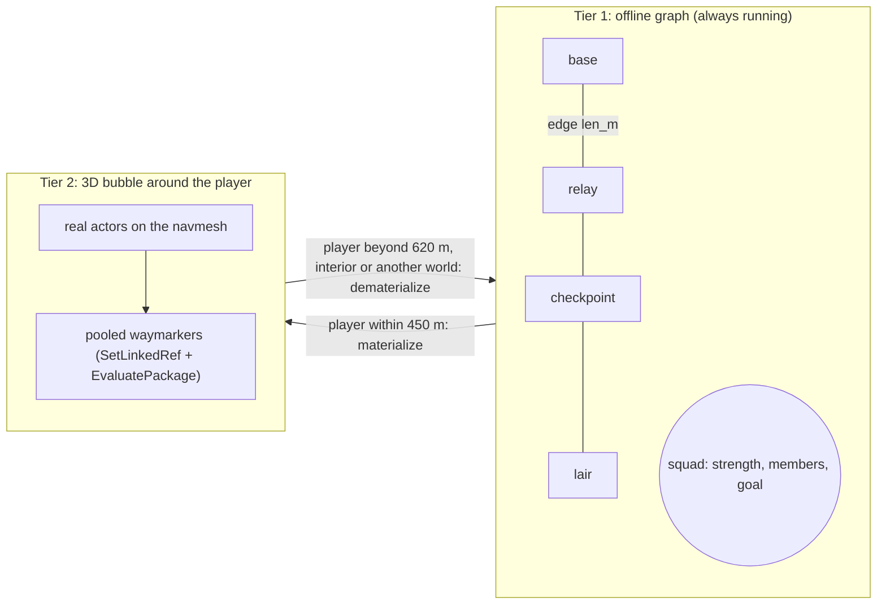

# Starfield A-Life Modder SDK: guide

Build your own offline A-Life layer for Starfield: squads of factions that live on a graph of smart terrains,
march, fight and take territory while you are far away, and appear as real 3D actors when you come near. You
describe the world in one JSON file (`alife_config.json`). The SDK checks it, simulates it offline, and packages a
ready-to-install mod (`<YourPlugin>.esm` plus compiled scripts). You do not need the Creation Kit.

> [!NOTE]
> Status: the toolchain, the plugin writer and the scripts are built and verified offline (unit tests, plugin
> self-checks, a real Papyrus compile). The in-game behaviour still has to pass the bounded checks in
> [STANDALONE-RELEASE-CHECKLIST.md](STANDALONE-RELEASE-CHECKLIST.md) before a v1.0 release. Treat today's builds
> as previews.

Contents: [architecture](#1-how-it-works) · [quickstart](#2-quickstart) · [config reference](#3-alife_configjson-reference) ·
[any worldspace](#4-adapting-to-any-worldspace) · [scripting API](#5-calling-a-life-from-your-own-mod) ·
[in-game options](#6-in-game-settings-and-the-field-transponder) · [troubleshooting](#7-troubleshooting)

## 1. How it works

A-Life runs on two tiers that hand squads to each other.



**Tier 1, the offline graph.** Your nodes (smart terrains) and edges form a graph of at most 128 nodes and 128
edges (one Papyrus array each). One quest script, `FO4SF_ALifeSimQuest`, ticks every `tick_real_s` seconds. Each
squad has a faction, a state (`garrisoned`, `marching_offline`, `online_3d`, `in_combat_offline`,
`dead_cooldown`), a current node, a goal and an edge position. Bases spawn squads for their current owner (one per
base per `respawn_cooldown_s`, up to the squad limit). A garrisoned squad waits 45 to 75 s, then takes an order
(when no candidate exists for the rolled order it falls through to the next):

| Order | Share | Goal |
|---|---|---|
| Raid | 40% | nearest hostile-held or unowned `base`/`checkpoint`, or other hostile node with capacity |
| Reinforce | 30% | nearest own node with a free garrison slot |
| Patrol | 30% | a random reachable node with capacity > 0 |

Routes are Dijkstra shortest paths. A full or relay goal reroutes the squad to the nearest free node. Two hostile
squads on the same node, or within 15 m on the same edge, fight an attrition battle on strength
(`members x combat_power`). A squad routs when its strength falls below a quarter of one member's power; it goes
into `dead_cooldown` and its slot frees after `respawn_cooldown_s`. A squad garrisoned at its own base regains a
member every quarter cooldown. A squad that holds a `base` or `checkpoint` with no hostile squad present captures
it.

**Tier 2, the 3D bubble.** When you are outdoors in the A-Life worldspace and come within
`online_spawn_radius_m` (450 m by default) of a squad's interpolated position, the script places its members with
`PlaceActorAtMe`, snaps them to the navmesh and drives them along the waymarker pool (4 to 16 persistent
XMarkerHeading references the plugin carries). A squad stuck for 60 s is relinked. When you move beyond
`offline_despawn_radius_m` (620 m), enter an interior or leave the world, the survivors are counted, the actors
are removed and the squad carries on offline with its new strength. The 170 m gap between the radii (it must be
more than 50 m) stops squads flickering in and out at the edge.

The offline simulator in the SDK (`fo4sf.alife.sim_math`) follows the same rules, so `simulate` previews the
balance of a config in milliseconds without the game.

**What the plugin contains** (FormIDs relative to your plugin):

| FormID | Record | Purpose |
|---|---|---|
| `0x000800` | QUST `<Prefix>_ALifeSim` | start-game-enabled quest running `FO4SF_ALifeSimQuest`, all arrays as properties |
| `0x000801`-`0x000804` | GLOB | SimEnabled, OnlineRadius, MaxSquads, Notifications |
| `0x000805`-`0x000808` | GPOF + GPOG | the Settings -> Gameplay options and their group |
| `0x000809`-`0x00080A` | MGEF + ALCH | the Field Transponder effect and item |
| `0x000810`-`0x00081F` | REFR | the waymarker pool in the worldspace's persistent cell |
| `0x000820`+ | FACT, NPC_ | one faction and one cloned squad template per config faction |

`<Prefix>` is `editor_prefix`, by default the letters and digits of your plugin name (`StarfieldALife`).

## 2. Quickstart

You need Python 3.10 or newer, the .NET 8 SDK (`dotnet`), and a Starfield install with the Creation Kit tools
(`Tools/Papyrus Compiler/PapyrusCompiler.exe`, `Tools/ContentResources.zip`, optionally `Tools/Archive2`). Run
everything from the repository root. The game folder is only read; nothing is written into it.

```powershell
# 1. a starter config (vanilla: Starfield.esm only; custom: your own worldspace plugin)
python scripts/alife/build_alife_mod.py init --out my-alife/alife_config.json --template vanilla

# 2. edit it, then check it: validity, connectivity, N/128 headroom, faction matrix, masters
python scripts/alife/build_alife_mod.py validate --config my-alife/alife_config.json

# 3. preview the balance offline (deterministic for a given seed)
python scripts/alife/build_alife_mod.py simulate --config my-alife/alife_config.json --ticks 1000 --seed 42

# 4. package (the output folder must be outside any Git checkout and outside the game folder)
python scripts/alife/build_alife_mod.py package --config my-alife/alife_config.json `
    --out "<somewhere>/MyALife-dist" --starfield-dir "<Starfield folder>" --pack-ba2

# 5. re-check the packaged folder at any time (every SHA-256, plugin header, scripts)
python scripts/alife/build_alife_mod.py verify-dist --dist-dir "<somewhere>/MyALife-dist"
```

`package` builds inside `<out>.partial-<time>-<pid>` and renames it to `<out>` only when every step passed: the
writer payload export, `dotnet/ALifeMod build` and `check`, the three Papyrus compiles, the optional BA2 pack, the
manifest and a final `verify-dist`. A failed attempt stays in the `.partial` folder for inspection. It refuses an
`--out` that exists, that is inside a Git worktree, or that is inside a game installation.

The packaged folder:

```text
MyALife-dist/
  Data/StarfieldALife.esm
  Data/StarfieldALife - Main.ba2      (with --pack-ba2: holds Scripts/*.pex)
  Data/Scripts/*.pex                  (without --pack-ba2: FO4SF_ALifeSimQuest, FO4SF_ALifeAPI, FO4SF_ALifeBeaconEffect)
  Plugins.txt.snippet                 *StarfieldALife.esm
  README-MOD.txt                      install and play notes for your players
  alife_config.json                   the config this build came from
  manifest.sha256.json                SHA-256 and size of every file, plugin masters, input hashes
```

**Install.** Zip the folder's contents and upload it, or install it locally:

- **Mod Organizer 2 / Vortex:** install the zip as a mod and enable the plugin in the plugin list.
- **Manual:** copy `Data` into the game's `Data` folder and add the line from `Plugins.txt.snippet` to
  `%LOCALAPPDATA%\Starfield\Plugins.txt` (the `*` enables it). Loose scripts (no `--pack-ba2`) are only read when
  `StarfieldCustom.ini` has `[Archive]` `bInvalidateOlderFiles=1` and `sResourceDataDirsFinal=`; the BA2 build
  needs no ini change, so ship that one.

**Read the in-game log.** With Papyrus user logging enabled, the runtime writes
`<Documents>/My Games/Starfield/Logs/Script/User/StarfieldALife.0.log`. Lines look like
`ALIFE_MOD rt=<seconds> step=<event> key=value ...`. Audit them independently of the script's own summaries:

```powershell
python scripts/alife/build_alife_mod.py log-audit --file "<Documents>/My Games/Starfield/Logs/Script/User/StarfieldALife.0.log"
```

It counts spawns, replenishes, 3D materializations, offline dematerializations, battles, captures per faction,
defeated squads, stuck relinks, warnings and errors, and exits non-zero when the log has no A-Life lines, no
`init`/`load_game`, or any `error` line.

## 3. `alife_config.json` reference

Keys that start with `_` are comments at any depth and are ignored (the `init` starter uses them). Unknown keys
are errors, so typos are caught.

### Top level

| Field | Type | Rule |
|---|---|---|
| `schema_version` | int | `1` |
| `mod_name` | string | 1..64 characters, shown in the README |
| `plugin_name` | string | bare `.esm`/`.esp`/`.esl` file name, not `Starfield.esm` |
| `light_master` | bool | `true` sets the Small (0x100) flag when the record count fits |
| `editor_prefix` | string | optional; a letter then up to 23 letters/digits; default from `plugin_name` |
| `masters` | list | starts with `Starfield.esm`; must list every plugin the worldspace or a template comes from. The built plugin's header carries only Starfield.esm plus the plugins its records still link to (always the worldspace plugin; a template plugin only if the cloned NPC_ keeps a link into it), so a vanilla config has exactly `["Starfield.esm"]` |
| `worldspace` | object | see below |
| `simulation` | object | optional; missing fields take the defaults below |
| `factions` | list | 1..8 entries |
| `nodes` | list | 2..128 entries |
| `edges` | list | 1..128 entries; the graph must be connected |
| `description`, `author`, `version` | any | optional, informational |

### `worldspace`

| Field | Rule |
|---|---|
| `plugin` | plugin the WRLD comes from (must be in `masters`) |
| `form_id` | hex string, plugin-relative (`"0x01251B"` or `"01251B"`); an 8-digit id's load-order byte is dropped; non-Starfield plugins start at `0x800` |
| `editor_id` | the WRLD EditorID |
| `merge_offset_xy` | `[x, y]` metres added to every node position to get in-game world coordinates; `[0, 0]` for vanilla worlds ([section 4](#4-adapting-to-any-worldspace)) |

### `simulation`

| Field | Default | Range | Meaning |
|---|---|---|---|
| `default_enabled` | `true` | bool | A-Life starts enabled on a new game |
| `tick_real_s` | `2.0` | 0.25..60 | seconds between offline ticks |
| `offline_step_m_per_s` | `1.35` | 0.05..50 | marching speed of offline squads |
| `online_spawn_radius_m` | `450.0` | 25..5000 | materialize squads closer than this |
| `offline_despawn_radius_m` | `620.0` | 25..10000 | dematerialize beyond this; must exceed the spawn radius by more than 50 |
| `waymarker_pool_size` | `8` | 4..16 | persistent waymarkers shared by 3D squads |
| `max_active_squads` | `8` | 1..16 | living squads at once (the in-game option can lower it) |
| `respawn_cooldown_s` | `120.0` | 0..86400 | per-base spawn interval and dead-slot cooldown |
| `show_notifications` | `true` | bool | brief on-screen battle/capture notes by default |

### `factions[]`

| Field | Rule |
|---|---|
| `id` | lower-case letter, then up to 23 of `a-z 0-9 _`; referenced by `relations`, `initial_owner`, `spawn_faction` |
| `index` | its position in the list (0-based) |
| `name` | 1..64 characters (your own words; the plugin's FACT gets `<Prefix>_Faction_<Id>` as EditorID) |
| `npc_template` | `{plugin, form_id}` of the NPC_ cloned for squad members; foreign quest scripts and factions are stripped, the squad faction is assigned, non-unique and non-essential |
| `player_relation` | `ally`, `neutral` or `enemy` |
| `relations` | `{other_id: ally/neutral/enemy}`; missing pairs are neutral; one side is enough (pairs are made symmetric) but both sides must agree when given |
| `squad_size` | 1..8 members per squad |
| `combat_power` | (0, 100]; strength per member in offline battles |

### `nodes[]` and smart-terrain kinds

| Field | Rule |
|---|---|
| `index` | its position in the list |
| `id` | 1..64 of letters, digits, `_ . : -`; unique |
| `kind` | one of the kinds below |
| `x`, `y`, `z` | metres in the config frame (world position = `x + merge_offset_x`, `y + merge_offset_y`, `z`) |
| `capacity` | garrison slots 0..16; `0` only for `relay`, at least 1 otherwise |
| `initial_owner` | faction index or id, or `-1`/`null` for unowned |
| `spawn_faction` | faction index or id makes the node a spawning base (it spawns for its current owner); `-1`/`null` for none |

| Kind | Typical use | Capturable | Garrison |
|---|---|---|---|
| `base` | settlements, outposts, faction HQs; usually the spawn points | yes | yes |
| `checkpoint` | gates, bridges, crossroads worth holding | yes | yes |
| `lair` | creature dens, raider camps; hold squads, not a territory flip | no | yes |
| `resource` | mines, wrecks, caches; raid and patrol targets | no | yes |
| `relay` | road junctions and corners that shape routes | no | never (capacity 0) |

### `edges[]`

| Field | Rule |
|---|---|
| `u`, `v` | node indices (or node ids); not equal |
| `len_m` | walking length in metres along the route; at least 0.75 x the straight-line distance between the two nodes (a longer road is normal; a much shorter one is a typo) |

### Building the graph from your own points

`fo4sf.alife.graph_builder` turns coordinate tables (CSV/TSV from xEdit exports or spreadsheets) or marker JSON
into nodes and edges: nearest-neighbour edges, bridges until connected, contraction of dropped nodes into longer
road segments, and caps at 128.

```powershell
python -m fo4sf.alife.graph_builder my-points.csv --template my-alife/alife_config.json --out my-alife/alife_config.json --k 3
```

Columns are matched loosely (`id`/`name`/`editor_id`, `x`/`pos_x`, `kind`/`type`, `capacity`/`cap`, ...). Run
`validate` afterwards.

## 4. Adapting to any worldspace

**A vanilla Starfield planet or POI world.** Point `worldspace` at the `Starfield.esm` WRLD (`plugin`,
`form_id`, `editor_id`), keep `merge_offset_xy` at `[0, 0]` and give node positions in that world's coordinates
(metres). Pick NPC_ templates from `Starfield.esm` too. Then `masters` stays `["Starfield.esm"]` and the mod
works for every player with no other plugin. The `vanilla_new_atlantis` preset is a worked example.

Getting positions: stand at a spot in game and use `getpos x` / `getpos y` / `getpos z` in the console, or export
marker references with xEdit. Starfield world positions are already in metres, so the values go straight into
`x`, `y`, `z` (check one known spot after packaging). Keep nodes on walkable exterior ground with navmesh, and
keep every node within the world's playable area.

**A total-conversion or custom world.** Use `init --template custom`, then set `worldspace.plugin` to your world
plugin, add it to `masters`, and set its WRLD `form_id` and `editor_id`. If your graph was authored in a local
frame (for example a converted map whose origin differs from the in-game world), set `merge_offset_xy` to the
offset that turns local metres into world metres: `world = local + merge_offset_xy`. The FO4SF Commonwealth preset
(`fo4sf_commonwealth`) does this with its measured offset; its masters are the world plugin and the plugin its
squad templates come from. Players then need those plugins too, and `package --extra-data-dir <folder>` finds
them for the build.

**Checklist for a new world:** every node position is outdoors on navmesh; `len_m` follows roads rather than
cliffs; at least one base per faction has `spawn_faction`; the faction matrix (`validate`) shows the conflicts you
want; `simulate` shows battles and captures but not one faction taking everything in the first 200 ticks.

## 5. Calling A-Life from your own mod

`FO4SF_ALifeAPI` is a hidden script of global functions. Your quest or magic-effect scripts call it without a
property: the API finds the A-Life quest (`0x000800`) in the plugin itself. Every function takes an optional last
argument `asPlugin`, the A-Life plugin's file name; `""` means `StarfieldALife.esm`, so pass your own
`plugin_name` if you renamed it. When the plugin is not loaded the functions return `-1`, `False` or `""`
instead of failing, so your mod can degrade gracefully. Compile against `scripts/alife/FO4SF_ALifeAPI.psc` and
`FO4SF_ALifeSimQuest.psc` from this repository.

| Function | Returns |
|---|---|
| `FO4SF_ALifeSimQuest GetController(string asPlugin = "")` | the running A-Life quest script, or None |
| `bool IsRunning(string asPlugin = "")` | A-Life loaded, initialised and enabled |
| `bool SetEnabled(bool abEnabled, string asPlugin = "")` | pause or resume the simulation (what the Gameplay option does) |
| `int SpawnSquadAtNode(int aiFaction, int aiNode, string asPlugin = "")` | the new squad slot, or -1 |
| `int OrderRaid(int aiFaction, int aiTargetNode, string asPlugin = "")` | the slot of the faction's free squad (nearest by graph) sent to raid the node, or -1 |
| `int GetNodeOwner(int aiNode, string asPlugin = "")` | owning faction index, -1 unowned |
| `bool SetNodeOwner(int aiNode, int aiFaction, string asPlugin = "")` | sets the owner (-1 = none) |
| `int GetActiveSquadCount(string asPlugin = "")` | living squads |
| `int GetNodeCount(...)`, `int GetFactionCount(...)` | graph and faction sizes |
| `int GetSquadState(int aiSquad, ...)` | 0 empty, 1 garrisoned, 2 marching offline, 3 online in 3D, 4 in offline combat, 5 dead cooldown |
| `int GetSquadFaction(int aiSquad, ...)`, `int GetSquadNode(int aiSquad, ...)` | a squad's faction index and current node |
| `string PrintStatusSummary(string asPlugin = "")` | a short status line, also shown on the HUD and logged (`step=status`) |

Faction and node arguments are the indices from your config (`factions[].index`, `nodes[].index`). API calls that
change state are logged as `step=api call=set_enabled|spawn|raid|set_owner`, so `log-audit` shows them.

```papyrus
Scriptname MyMod_OutpostQuest extends Quest
{ Example: when the player clears the outpost, hand it to the allied faction and send a raid at the next node. }

Int Property OutpostNode = 4 Auto Const      ; nodes[4] in the A-Life config
Int Property AlliedFaction = 0 Auto Const    ; factions[0]
Int Property NextTargetNode = 7 Auto Const

Function OnOutpostCleared()
    If !FO4SF_ALifeAPI.IsRunning()
        Return                               ; A-Life not installed or disabled: the quest still works
    EndIf
    FO4SF_ALifeAPI.SetNodeOwner(OutpostNode, AlliedFaction)
    FO4SF_ALifeAPI.SpawnSquadAtNode(AlliedFaction, OutpostNode)
    Int raider = FO4SF_ALifeAPI.OrderRaid(AlliedFaction, NextTargetNode)
    If raider < 0
        Debug.Trace("MyMod: no free squad to raid with yet")
    EndIf
EndFunction
```

```papyrus
Scriptname MyMod_StatusActivator extends ObjectReference
{ Example: an activator that reports the A-Life war of a renamed A-Life plugin. }

String Property ALifePlugin = "MyALifeMod.esm" Auto Const

Event OnActivate(ObjectReference akActionRef)
    If akActionRef == Game.GetPlayer() && FO4SF_ALifeAPI.IsRunning(ALifePlugin)
        Debug.Notification("Active squads: " + FO4SF_ALifeAPI.GetActiveSquadCount(ALifePlugin))
        FO4SF_ALifeAPI.PrintStatusSummary(ALifePlugin)
    EndIf
EndEvent
```

**Console (testing only).** `cgf` entry points on the same script:

| Command | Effect |
|---|---|
| `cgf "FO4SF_ALifeAPI.Status"` | status of `StarfieldALife.esm` |
| `cgf "FO4SF_ALifeAPI.StatusFor" "MyALifeMod.esm"` | status of another A-Life plugin |
| `cgf "FO4SF_ALifeAPI.Enable"` / `cgf "FO4SF_ALifeAPI.Disable"` | resume / pause |
| `cgf "FO4SF_ALifeAPI.Spawn" <faction> <node>` | spawn a squad |
| `cgf "FO4SF_ALifeAPI.Raid" <faction> <node>` | send a raid |
| `cgf "FO4SF_ALifeAPI.Capture" <node> <faction>` | set a node's owner |

Players use the Gameplay options and the Field Transponder instead.

> [!IMPORTANT]
> `scripts/alife/FO4SF_ALifeAPI.psc` is the source of truth if this table and the script ever differ.

## 6. In-game settings and the Field Transponder

**Settings -> Gameplay** gets an A-Life group (the plugin's GPOG with three GPOF options):

| Option | Effect |
|---|---|
| A-Life enabled | on/off; off removes 3D squads and pauses the offline graph without losing state |
| Maximum squads | 1..16 living squads (capped by `max_active_squads`) |
| Notifications | brief battle and capture notes on or off |

The options are read at start and on every save load (`OnPlayerLoadGame`), so changes apply after closing the
menu and on the next load.

> [!WARNING]
> Unverified in game: the A-Life option group is written as a standalone group, not linked under the vanilla
> Gameplay root (that would add a master beyond `Starfield.esm`). Whether it shows in the menu is check G2 of
> [STANDALONE-RELEASE-CHECKLIST.md](STANDALONE-RELEASE-CHECKLIST.md). The console `cgf` commands and the API work
> without the menu.

**Field Transponder.** On start the quest gives the player one Field Transponder (an aid item). Using it reports
the nearest squad and the territory picture (nodes held per faction) in a message box, without the console. It is re-added after each use, so it is never lost.

## 7. Troubleshooting

| Symptom | Check |
|---|---|
| `validate` says not connected | add edges between the components it lists; relays help |
| `len_m ... shorter than the straight-line distance` | measure the walking route; it may not be under 0.75 x the straight line |
| `simulate` shows no spawns | a base needs `spawn_faction` and its `initial_owner` set to a faction |
| one faction takes everything | lower its `combat_power` or `squad_size`, add checkpoints, raise `respawn_cooldown_s` |
| `package refused: ... Git worktree` / `game installation` | choose an `--out` outside every repository and every game folder |
| `master X not found` | pass `--extra-data-dir` holding the plugin, or remove the reference |
| no squads in game | `log-audit` the log: no `init` means the quest never started (plugin not enabled, or loose scripts without the ini change) |
| squads stand still in 3D | the NPC template needs AI that follows a linked reference; look for `stuck_relink` in the log |

Uninstalling a scripted mod mid-save leaves data in that save: disable A-Life in the Gameplay options and save
first, or keep a save from before installing.
