# Playtest issues (the owner's "look" reports)

Each row: what the owner said, the snapshot (`scripts/game/snapshot.ps1`: screen, bridge position and cell, Papyrus
tail; nothing typed into the game), what the build's own records say, and the next step. Rows 1 to 26 are from the
16 and 17 Oct sessions on `terrain_core64f` / core64k + the pinned interior build `FO4Port.esm` (integ_1011 /
integ_1018). Rows 27 on are from 22 Oct on v6i_plainshader (core DC751664, port 9AF962D2, mission 03C2A7A8);
FO4SFMapMarkers was installed at 11:50 UTC, after row 27, so it is part of the build from row 28 on. Rows 31 to 38 are
the owner's section A session of 23 Oct (reported 15:46 UTC) on the same build with the bridge door-script set t4 and
the quest probe installed; the owner reported in one message, quoted here in parts with typos fixed.
Row 39 is from 24 Oct, card B (the owner's message of 16:25 UTC, quoted with typos fixed), on v6i_plainshader with the
markers plugin carrying the border signal (mapmarkers_v6i_landing_border) and the SFSE plugin FO4SFBorder switching
the border (Mode 2).

| # | When / where | Owner | Evidence | Cause | Next |
|---|---|---|---|---|---|
| 1 | 16 Oct 10:35, Vault 111 (FO4Port_Vault111Cryo, cell 020011F3, pos -3.83 -7.44 0.01) | "These doors don't work" | 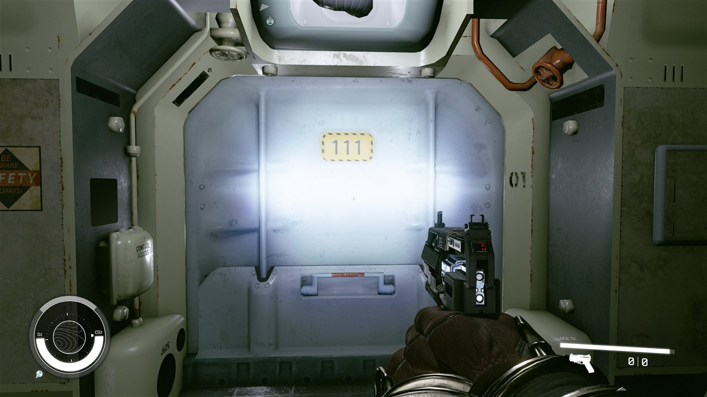 facing `V111Door01b` (001977) | **verified** (manifest): 10 FO4 door bases, the Vault 111 doors among them, are converted with `door_not_opening: open animation not ported: passable` (placed as statics without collision so the player walks through); only 29 hinged door bases are rigged and open | Port the vault door animations (slide / cog) or rig them with a matching Starfield sliding-door graph; meanwhile walk through. **16 Oct, offline:** no vanilla door moves like them (123 rigs read back), so all 10 bases now get their own rig with FO4's keys on the vanilla graph (branch `claude/slide-doors`, [sliding-doors.md](../spikes/sliding-doors.md)); needs an overlay build with `--door-anim-dll` and a game test **Owner-verified 17 Oct 00:10-00:12 (core64k + integ_1018):** "the vault 111 sliding doors are working correctly". |
| 2 | 16 Oct 10:36, Vault 111 (same cell, pos 6.20 38.97 -1.81) | "This table doesn't show up" | 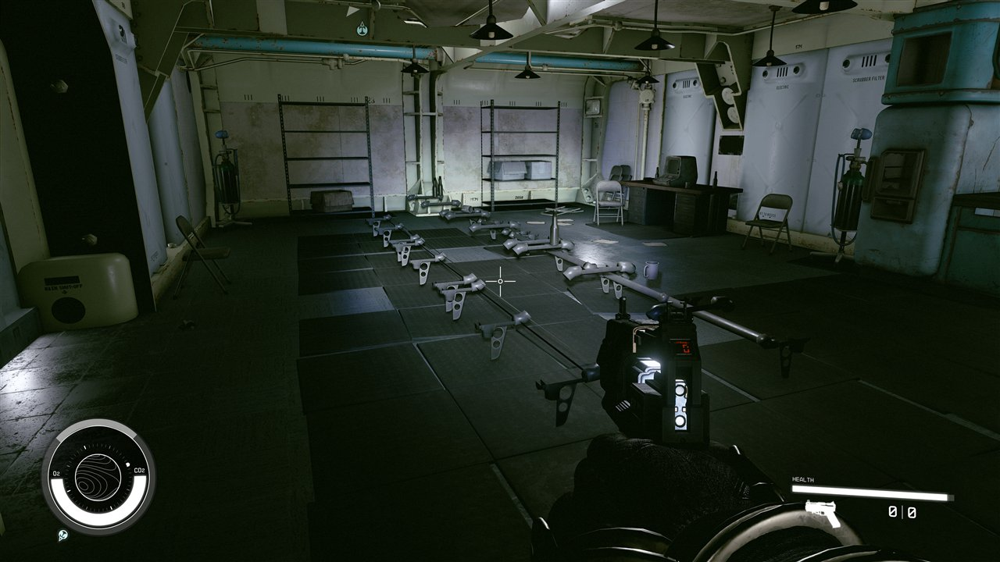 the leg frames of `NpcTableVaultSit02` (0AB570, 0AB56F; model `SetDressing\Vault\Vault_Table_02.nif`) render, the table tops do not | **supported hypothesis**: the converted NIF has one shape (`shapes 1`, no fallback material) and its collision converted (`fo4-native`, 1 body); the top's triangles are missing or culled in the converted geometry, not the reference | Owner check: jump onto where the top should be (collision there = a render-only loss); converter check: FO4 source triangle count vs the converted `.mesh`, normals/winding of the top faces |
| 3 | 16 Oct 10:37-10:39, Vault 111 | "Shooting certain things with the shotgun crashes the game": a door, an object that should have collision, certain walls and floors | Windows Application log: **4 crashes in 3 min, all `Starfield.exe` 1.16.244, exception 0x80000003 (a deliberate break / failed engine assertion) at the same offset `Starfield.exe+0x36F418B`** (reports 50262f9e, 6b497d17, 49892954, d9048939) | **supported hypothesis**: one code path, hit by many converted objects: the bullet-impact lookup on converted collision. Converted collision keeps FO4's own collision data (`fo4-native` in the manifest) and its physics material, which is likely not one of Starfield's impact materials, so the hit's material/impact-data lookup asserts. The 'it depends' pattern fits: objects whose collision came from a vanilla Starfield template (e.g. the rigged hinged doors' box) would not crash | Isolate with one test per collision source (shoot a template-box door vs a fo4-native wall); then map FO4 havok materials to Starfield's at conversion. Until then: don't shoot converted objects **Owner-verified 17 Oct 00:10-00:12 (core64k + integ_1018):** "No crash btw" after shooting in Vault 111 again. |
| 4 | 16 Oct 10:48, Vault 111 reactor hall (cell 020011F3, pos -41.56 3.79 0.02) | "A bunch of broken textures, certain things not placed correctly" | 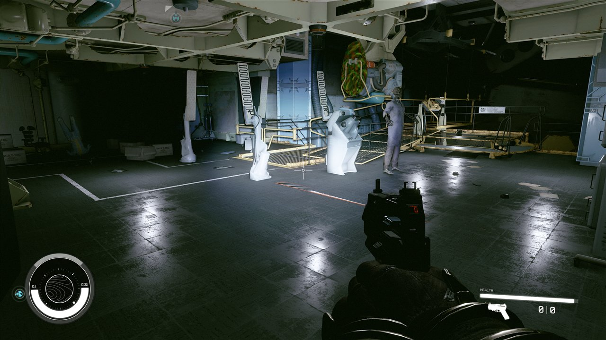 | Three visible kinds, **supported hypotheses** from the picture (the manifest shows only one fallback material within 20 m, a water plane, so these are not converter fallbacks): (a) **plain white** pedestals and tall panels: their color texture is not found at run time (missing from the texture archive or a path the material names wrongly), Starfield draws missing color as white; (b) the **red/green stripes** on the round machine: a 2-channel FO4 normal map (BC5, red/green) in the color slot; (c) the **standing pale figure** by the reactor: **verified** (2026-10-16): the lab-coat skeleton `Vault111SkeletonScientist02` of row 5, drawn in its skin's bind pose (cause and numbers in row 5) | Per object: the owner's texture work covers (a) and (b); for each, the converted .mat's texture slots vs the archive's files. (c): the converter now poses it with its XRGD (row 5; offline, not yet in game) |
| 5 | 16 Oct 10:50, Vault 111 entrance / decon (cell 020011F3, pos -41.99 -4.45 0.05) | "Misaligned stuff" | 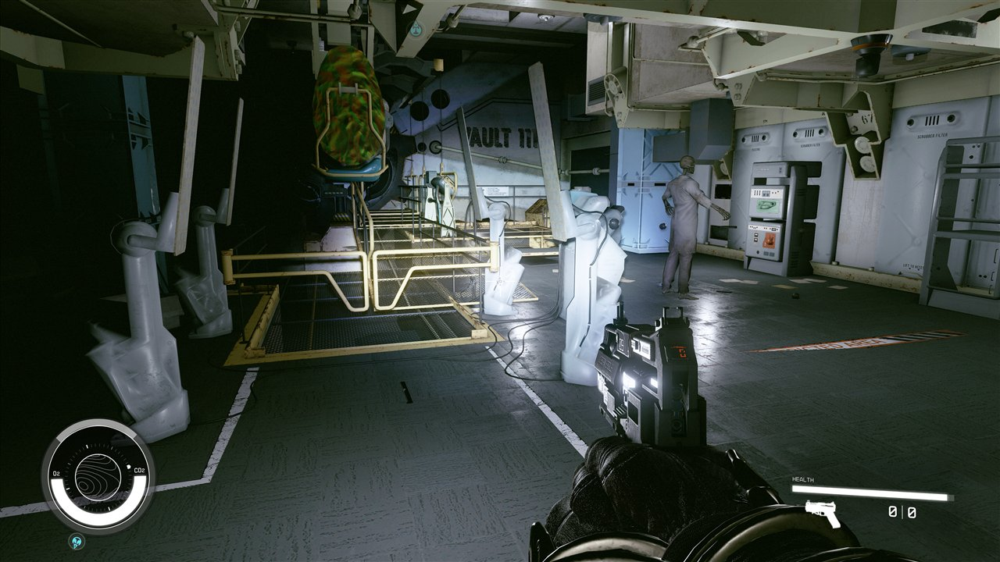 | **verified** which objects: the white posts with tilted, detached panels are the 4 radiation scanners `V111RadScanner01` (2 shapes converted, fo4-native collision, no note), the standing skeleton in a lab coat is `Vault111SkeletonScientist02` (an Activator of 3 shapes; a sibling base notes "17 FO4 bodies merged"). **Verified 2026-10-16** ([research log](../ai/research-log.md), same date): the skeleton stands in its skin's **bind pose** because this build (commit `a5bc92e`) has neither the node-pose bake (#45 / #46) nor the XRGD pose (#52), which were never merged; its reference 1A6736 carries 17 ragdoll entries that lay it on the floor. The scanners are **not** posed models (no skin, nothing moves their parts; the converted mesh equals FO4's): the tall panel is authored 10 degrees off vertical and carries FO4's glow quad, an effect shape the converter skips, so it shows as a bare slab ([FO4 source](../media/posed-props/1016-v111-radscanner-fo4-source.jpg)). In the 16 interiors 231 placed references share the pose cause (180 skinned in the bind pose, 147 with an XRGD pose) | Fixed offline (Claude's posed-props PR): skinned props in the NIF's node pose, references with XRGD get a posed model of their own ([before / after](../media/posed-props/1016-v111-scientist02-bind-node-xrgd.jpg)); look in game after the next interior build. Scanners: convert FO4 glow quads (effect shaders) as an emissive material (open) |
| 6 | 16 Oct 10:53, Vault 111 exit elevator (cell 020011F3, pos -64.67 -1.50 0.30) | "Look" (no description) | 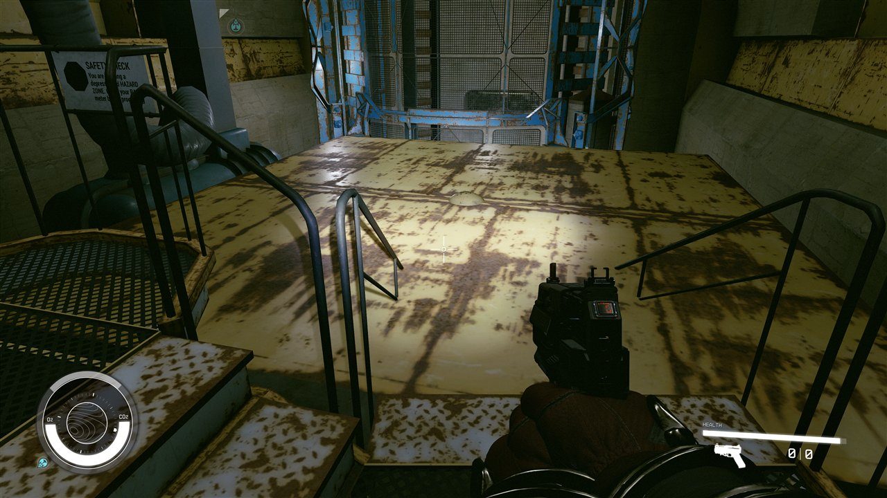 the yellow exit-elevator platform and its blue cage | **verified** (manifest): the elevator `VltElevator` (FO4 Activator) is converted as a model only (45 collision bodies, no script, no animation), and its call activator `vaultExitElevatorDown` is **not converted**, so the platform cannot rise to the surface; the gear-room gate `V111GearRoomGate01` has **no collision**: its collision conversion failed (`TypeError: object of type 'NoneType'`); the cog door `VltGearDoor01` is a static (as row 1) | Elevator: an animated platform + its activator (same family as row 1's doors); the gate: fix the collision converter's None case (a converter bug, reproducible offline). **16 Oct:** what Starfield's own elevators need and what is in reach: [sliding-doors.md, "Elevator"](../spikes/sliding-doors.md#elevator-owner-row-6-what-it-needs) (the ride up the shaft looks buildable from records; the exit to the surface waits for the door gate). The cog door is a scripted activator, not a door (same page) **Owner-verified 17 Oct 00:10-00:12 (core64k + integ_1018):** "the vault 111 sliding doors are working correctly". |
| 7 | 16 Oct ~11:00, Starfield map | "Fast travel to the Frontier (it looked like a building by it) put me in a permanent loading screen" | The bridge log rotated at 11:00:55 (a load began) and has written nothing since, with the game still running: the load never finished | **supported hypothesis**: fast travel out of our worlds into a vanilla destination does not complete; our overlay worldspace has its own Location registered on Mars, but none of the map / fast-travel data a vanilla landing site has (map markers, the ship landing chain) | Until fixed: no map fast travel from the converted worlds; use `coc` (sheet section 1). Fix: map markers and a valid location chain for the overlay (plan section 5) |
| 8 | 16 Oct 10:55-10:56, Red Rocket | (from the bridge log, with the owner's question "was the Red Rocket command supposed to drop me at Red Rocket?") | 10:55:17 `coc FO4Core_RedRocketSpawn` arrived **exactly at the arrival marker** (-2189.26, -1553.49, 105.44); 10:56:13 the player was 11 m west at **z 19.38, 86 m below the ground** (cell 50335087) | **supported hypothesis**: the player fell through the world inside / next to the station building, 11 m west of the forecourt: a floor whose collision is missing (cf. row 6's gate: a collision conversion error leaves an object without collision) over terrain the player then also passed | Find the building pieces at (-2200, -1556) whose collision report has an error or none; check the BTD there; a walk queue from the forecourt into the station |
| 9 | 16 Oct 11:02, after `coc FO4Core_RedRocketSpawn` | "It didn't put me there" | 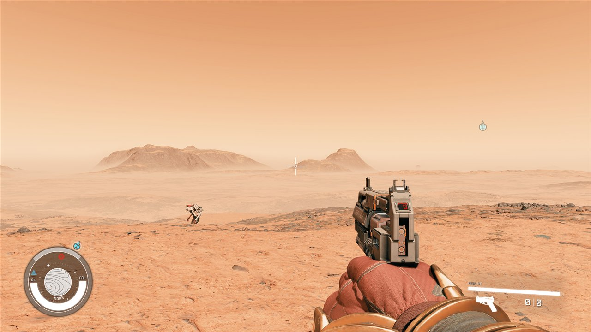 bare Mars; bridge: pos -2194.26 -1581.58 **21.57** in world FF010AF2 (the right x/y, the wrong ground) | **verified, Claude's install error, not the build**: the owner's install (16 Oct 01:00) put core64f's Data as 51,824 loose files (`pack False`); this Starfield's ini has `sResourceDataDirsFinal=STRINGS\` only, so loose meshes, terrain (BTD) and textures are never read: no Commonwealth heights, no objects, the player drops to Mars's own ground. Row 8's "fall through the world" is the same cause. Every runner queue installs with `--pack` (one stored archive) and was unaffected | Reinstalled with `--pack`; rule for the owner's installs: always `--pack` (or loose-file ini keys, which the project does not set) |
| 10 | 16 Oct 14:14, Vault 111 entrance elevator (cell FO4Port_Vault111Cryo, player at -73.4 -8.9 -0.3) | (look button, no words) | 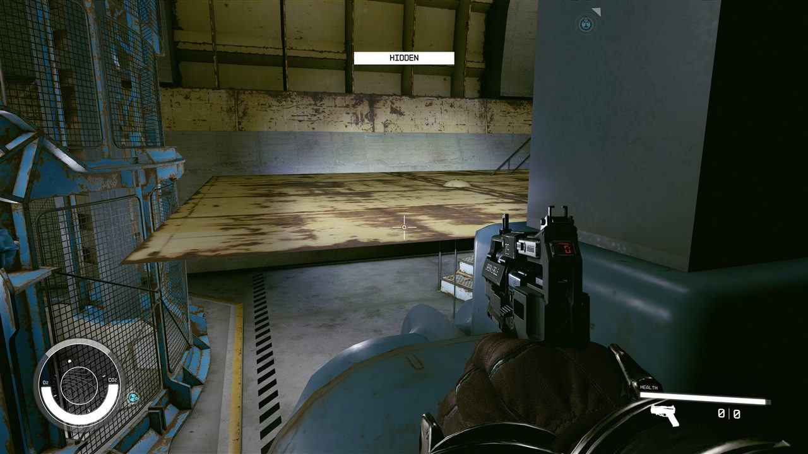 a large rusty plate floats tilted above the floor beside the elevator, and a plain grey block stands next to it. The only modelled objects within 7 m are the elevator activator `VltElevator.nif` (FO4 0244EB) and the entrance shell `VltOutsideEntrance01.nif`: the elevator's moving parts render in their rest pose (the plate is its platform or roof), the same family as row 5 (posed props) and row 6 (the elevator does nothing). | **open**: the elevator is an animated activator; the door-rig work (#242) covers 10 door bases, not VltElevator; candidate: the same rig path for the elevator |
| 11 | 16 Oct 14:15, Red Rocket station (world FF010A13, player at -2195.7 -1545.4 105.4) | (look button, no words) | 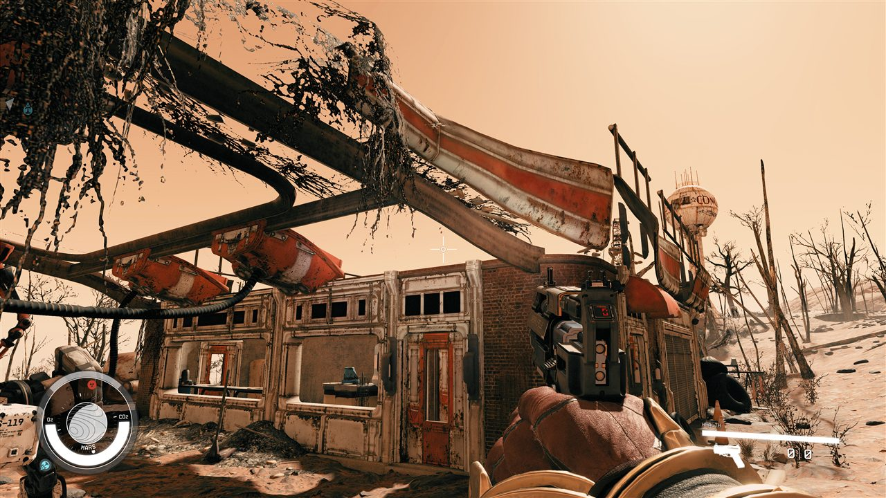 the hanging vines over the station render as black jagged strands; the building, pumps, signs and the Concord water tower look right. The objects 4-5 m overhead at that spot are `vinehanging06`, `vinehanging07`, `vinehanging08` and the `vinecreeper*` family (core64h objects.json). | **verified offline** (PR #288): vine.mat cloned an opaque metal parent; now clones ConduitKit01TwoSided, writes Summary Opacity, and emits an enabled zero-metalness TextureReplacement (review fix: the template has no index-4 replacement of its own). In-game after a vine-family reconvert (Claude). |
| 12 | 16 Oct 14:16, Red Rocket garage | "The workshop shouldn't just be treated as a container as well, not just a texture issue" | The FO4 workshop (WorkshopWorkbench) is one of the 5,185 promoted containers in core64h; the crafting benches are statics. The owner wants them mapped to Starfield's own systems: the workshop to outpost build mode, the benches to native crafting stations. | **researching** (workflow 16 Oct 14:25: outpost build mode in our worldspace; FO4 benches -> Starfield FURN) **Owner-verified 17 Oct 00:10-00:12 (core64k + integ_1018):** "The workshop ... at the red rocket work[s]": the garage workbench opens Starfield's build mode. |
| 13 | 16 Oct 14:21, Sanctuary, inside a ruined house (world FF010A13, player at -2322.6 -1424.8 112.1) | (look button, no words) | 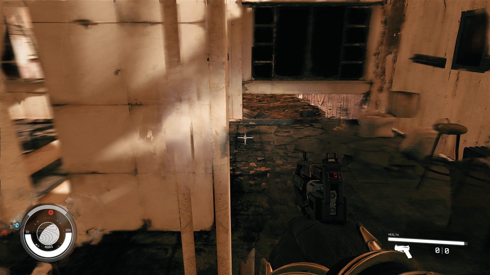 the interior wall panels render as flat bright white with smeared detail; the floor, the chair and the window frame look right. The pieces there are the `playerhouse_ruin_*` family (kitchen cabinets, stove, refrigerator; core64h objects.json within 3 m). | **open**: textures (same family as row 4: a wall material whose colour map is missing or white); next textures pass |
| 14 | 16 Oct 14:21, Sanctuary, the yard | (look button, no words) | 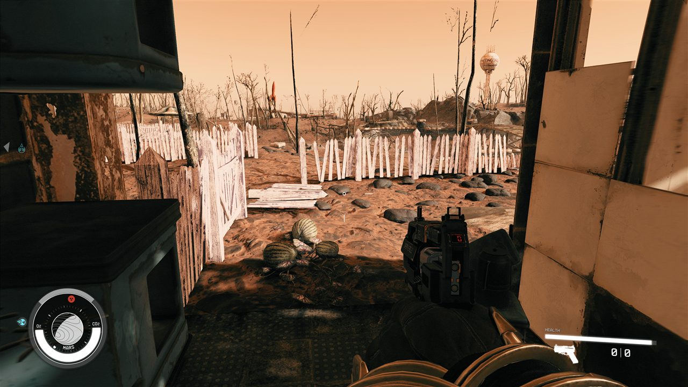 melon plants, the picket fence and a white panel on the right. In FO4 crops (melon, tato, mutfruit, corn) are harvestable FLOR records; here they are statics, like every other FLOR. | **open**: a FLOR promotion class (harvestable plants) is not built yet; the white panel joins row 13's textures pass |
| 15 | 16 Oct 14:23, Concord, Museum of Freedom roof (cell 03000E2E, player at -1997.2 -1721.3 98.0) | (look button, no words) | 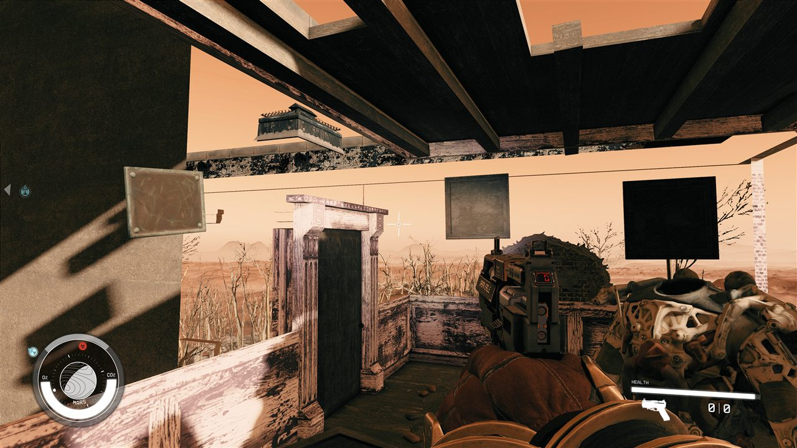 the picture frames and the brass plaque (`pictureframe03` x2, `brassplaque`) render as flat grey and black boards; the power armor spot (`powerarmorfurniture` 0370E3, 2.3 m) shows a mangled white skinned mesh in its rest pose; the roof door frame (`bldwoodpdoorload01`) is a load door into the unconverted museum. | **verified not a palette material** (PR #289, Claude review of vanilla BA2s): both painting BGSMs have empty greyscale and `bGrayscaleToPaletteColor` off; BrassPlaque is a cubemap, flags1 bit 0x10 clear. The canvases are FO4 material swaps (`PaintingGeneric*`), which this repo does not read. Palette bake still lands for the 278 flagged BGSMs. Power armor is a class not built; the door waits for interiors. |
| 16 | 16 Oct ~14:30, Red Rocket | "picking up those items and running around ... all of that stuff worked" | The owner's confirmation of what the runner could not evidence: loose items (core64h, 12,438 MISC references) go into the inventory on activation. | **verified by the owner**: the items milestone is complete **Owner-verified 17 Oct 00:10-00:12 (core64k + integ_1018):** "other containers at the red rocket work. The scanner is showing containers and items." |
| 17 | 16 Oct ~14:50, console teleport from the Red Rocket arrival towards Diamond City's exterior | "i hit a boundry when using the tp ... saying i need to go to my ship or the map" | The console history shows the three `player.setpos` lines were pasted as ONE line, so only `x -636` applied: a single 1,549 m jump east. "Boundary Reached" is Starfield's native BoundaryMenu (no GMST, no MESG, no script; the text is a UI translation key), and this repo's own runs showed it is raised by single jumps beyond about 2 cells (200 m), while 300 m hops reached 2 km with no popup (journal 12 Oct) and the 6.4 km overlay streams in as the player moves. Whether a real landing-tile edge exists on foot is unproven (hypothesis: planet-content blocks of 3-4 km plus a 5-cell buffer). | **open, likely not a wall**: the owner retries with one line at a time and 200 m hops (or `tcl` and travel on foot); if a hop raises the popup, that x/y is the real edge. Permanent route either way: more arrival markers (Diamond City, Boston, Concord, Lexington, Cambridge, the Glowing Sea) |
| 18 | 16 Oct 14:32, Vault 111 (bridge log stops at 14:32:36, player at the cryo end) | "Straight to desktop with no message" ... "the doors in vault 111 but the items vary" | The shooting crash reproduced: no Windows error event and no Windows Error Reporting entry this time (the engine ends the process itself), so the WER dump setting did not fire. The trigger: the Vault 111 doors crash it every time, loose items sometimes. Hypothesis: our fo4-native collision bodies carry Fallout 4 havok material codes Starfield's impact system does not know (the doors kept native bodies; items are split between native bodies and guessed boxes). | **open**: ProcDump watcher armed (C:\Modding\tools\crashwatch.cmd, first-chance 0x80000003 -> D:\crashdumps); offline material comparison running (16 Oct 15:30) **Owner-verified 17 Oct 00:10-00:12 (core64k + integ_1018):** "No crash btw". |
| 19 | 17 Oct 00:02-00:03, Vault 111 (integ_1018 + core64k) | "These gates that are supposed to have walking physics don't have it" | 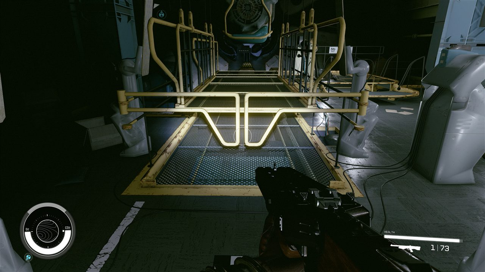 the gear-room gates (`V111GearRoomGate01`) let the player through although since #230 their NIF holds FO4's native bodies (4 convex leaves, collision filter 0x8037 = layer 55 L_CLUTTER_NOCUT, static) and before that 39 guessed L_STATIC boxes let him through too. Also seen in the same shots: the vault-suit skeleton lies properly on the floor now (#244) and the elevator cage renders. | **cause found, fix built**: the gate leaves keep FO4's collision layer 55 (L_CLUTTER_NOCUT, pushable clutter that must not cut the navmesh), which Starfield's character controller walks through (vanilla uses that layer only on the New Atlantis turnstile leaves); FO4's gate is passable too, by swinging on its hinges, and our conversion freezes the leaves. Fix: frozen layer-55 leaves are written as L_STATIC (meshcollision.static_filter); the gate becomes a solid rail across the walkway (jumpable), until hinge constraints are converted. In-game check after the next interior rebuild. |
| 20 | 17 Oct 00:03, Vault 111, a utility room with a blue pump | "the floor texture I just sent isn't right" | 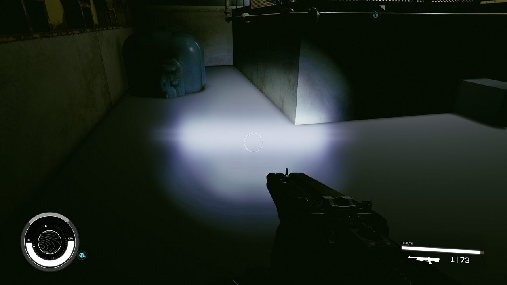 the floor renders as a flat light-grey surface with no tile detail under the flashlight. | **cause found (offline), fix in PR #300, in-game check pending**: it is not a floor texture. The surface is the placed water plane `Water\Water1024.nif` over the gear room's sunken pit, converted as a static: an opaque quad in the neutral fallback material (uniform grey, no detail) with a solid L_WATER body, so the player (z -1.9429 = the plane's top, **verified** from the bridge read) stood on it 0.44 m above the real cement floor (z -2.38, whose converted material and textures are fine). Not a palette material (#289 does not apply). #300 leaves placed water planes out of interior builds, as the exterior path already did; the first read after a rebuild should be z about -2.38 |
| 21 | 17 Oct 00:08, Red Rocket garage (core64k) | "That button is supposed to control the garage door" | 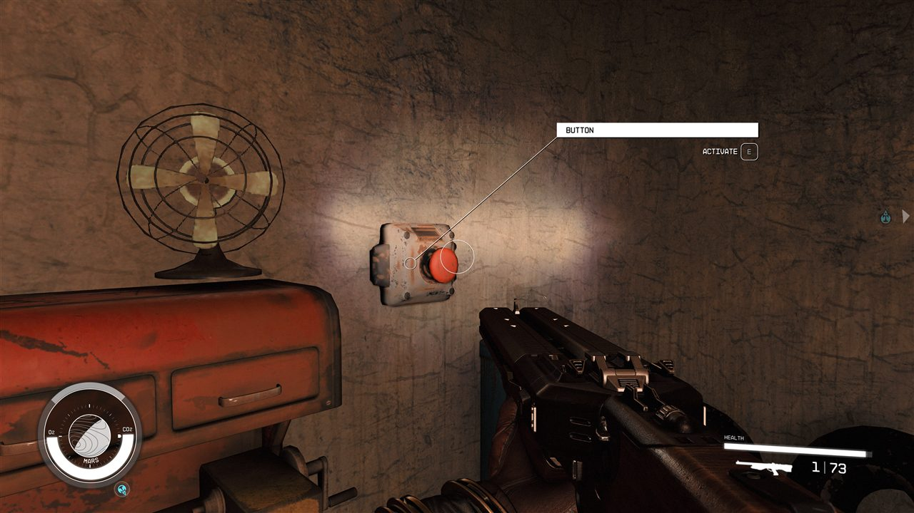 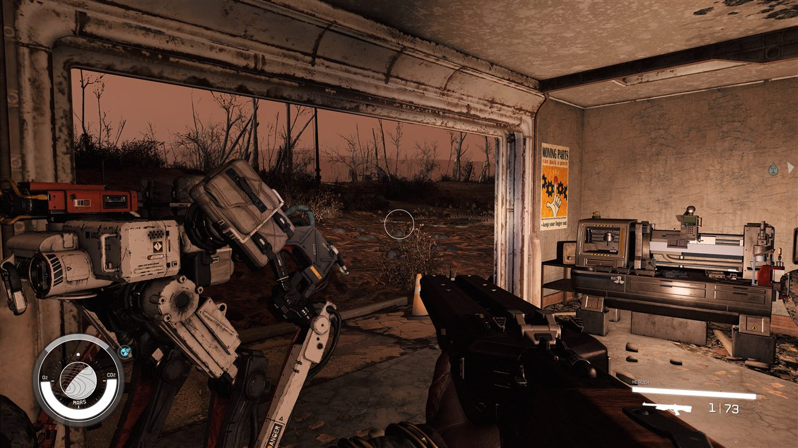 the wall button is a promoted activator (it shows BUTTON / Activate), but nothing is wired behind it: in FO4 it links to the garage door and a script toggles the door's open/close animation. The exterior build only turns load doors into scripted doors; non-load animated doors (this garage door, the lit side door) are plain statics there, while the interior build rigs them (which is why Vault 111's sliding doors work). | **offline**: Grok writer wires vanilla `DefaultActivateLinkedRefOnActivate` + XLKR LinkCustom02 on the two Commonwealth pairs ([garage-button.md](../terrain/garage-button.md)); garage animation/receiver is later Claude work, not this PR |
| 22 | 17 Oct 00:09, Red Rocket garage, `set gamehour to 22` | "The lights are very bright" | 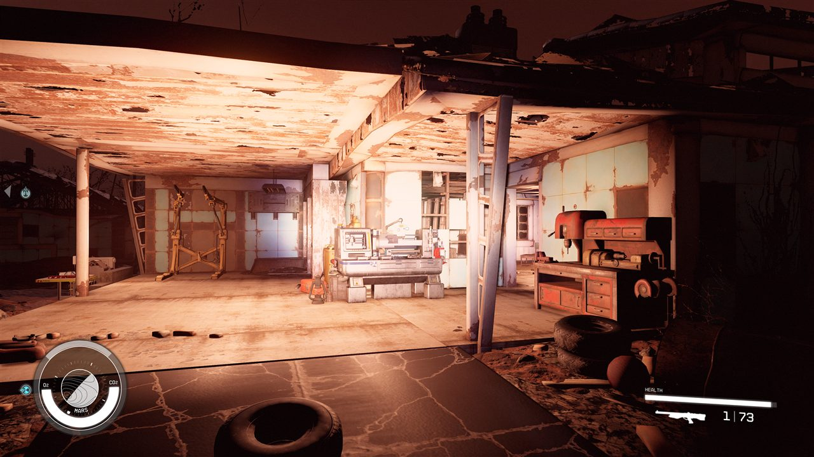 the garage ceiling and walls wash out orange-white under the promoted lights. | **open**: investigation running (the FO4 fade -> lumens mapping, radius, overlap of FO4's fill lights, flags vs vanilla fixtures) |
| 23 | 17 Oct 00:09, Red Rocket garage | "You do still need to replace some of the textures for the workstations. It's using the Starfield stuff, but that is not the most important." | 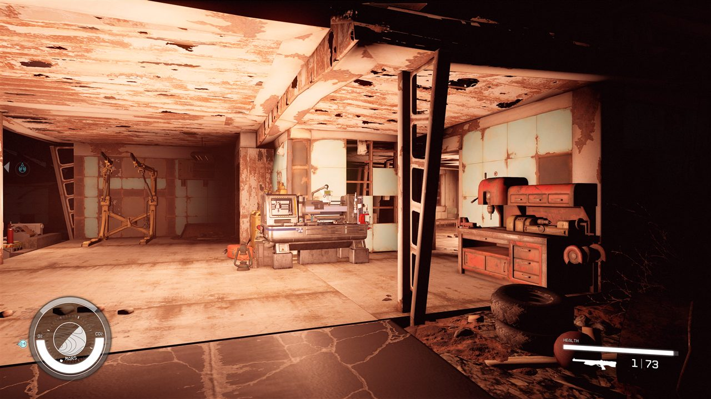 the benches are bound to vanilla Starfield FURN records, so they render Starfield's bench models. | **open, low priority (owner)**: FO4 bench models on the vanilla crafting records (the FURN's model swap, or copies of the vanilla FURN with the converted meshes) |
| 24 | 17 Oct 00:12, Red Rocket, from the ground | "We also might need to build a mod or something to do something with render distance because even from the ground, there's extremely long distances you can just see nothingness" | Starfield loads a small block of cells around the player and draws only terrain plus distant-LOD meshes beyond it; our converted statics have no LOD, so the world ends a few cells out. FO4 hides this with generated LOD. | **research**: object LOD is `lodsettings/*.lod` + `meshes/lod/generated/…_lod_0..3.nif`; core64k has none; do not raise `uExterior Cell Buffer` ([object-lod.md](../terrain/object-lod.md)). Next: CK generate on a tiny overlay (Claude) |
| 25 | 17 Oct 00:13, Diamond City gate (walked from Red Rocket) | "Nothing wrong besides really bright lighting, it's worse on my end than the screenshot, but I can walk to diamond city freely" | 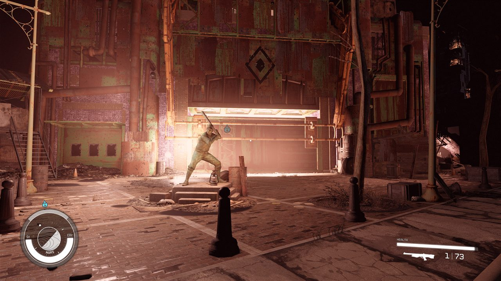 **owner-verified**: the whole walk Red Rocket -> Diamond City on core64k, no crash, no Boundary Reached, the gate and the statue render; the gate lights wash out like the garage (row 22; HDR in game is harsher than the capture). | **verified** (lighting tracked in row 22) |
| 26 | 17 Oct 00:55, exterior and interiors (core64k + integ_1018) | "picking up items in the world and moving them (not putting them in your inventory) doesn't work still, idk if you tried to fix that yet" | Not fixed yet. Known since 15 Oct (research log): converted items keep FO4's Havok masses, 2 to 10 times Starfield's for small things (a burnt book 25 kg, a bobby pin box 50 kg; vanilla dynamic items median 10 kg), and whether the mass is what stops Starfield's grab is unresolved. | **open, experiment ready**: the owner selects an object they cannot carry (`prid` on it, or click it in the console), runs `cf "ObjectReference.SetRigidBodyMass" 2`, and tries to carry it again; if it lifts, the converter scales masses to Starfield's range |
| 27 | 22 Oct ~11:25 UTC, Sanctuary, Codsworth's spot (world -2348.21 -1412.55 111.74, cell 03000D30) | "Codsworth not visible at his spot"; later "ok got codsworth" after the console line; afternoon session: `prid 06000811` / `07000811` not found, `prid 05000811` worked | His model renders correctly on the plain-shader build (the owner's screenshot), so the crash fix holds. He was absent on the owner's existing save until `prid <index>000811`, enable, moveto player. Install read Plugins.txt rewritten at 11:26:20 local, 25 s after the launcher started the game, with FO4Port moved from first to after FO4SFMission, so the mission's index went from 06 to 05 ([load-order.md](../testing/load-order.md)). | **supported hypothesis**: his state on that save (the mission's Codsworth check never armed there, or he is disabled), not the model. Not shown. | Bugs, with NPC and Interiors: the keeper-quest fix (#493) is merged but in no installed plugin; with no core rebuild it needs its own FO4SFMission build against the installed v6i core and the owner's install line, then card K (read-only, on a save from before the 22 Oct console fix) as the in-game proof; not a phase 0 gate (ROADMAP checklist); owner instructions name him, never a console index |
| 28 | 22 Oct 17:36 to 17:41 UTC, surface map | "the map is the only issue", then "no i just went back to the area and their now on the surface" | fo4sf_map.0.log: the mover quest started at rt 55 s and moved all 4 markers (Red Rocket, Sanctuary, Vault 111, Concord) at rt 70 s, each with `before=` FLT_MAX (the first position read failed). The four icons drew after the owner came back to the area. | **verified in game**: the markers plugin works. Why the icons were not there at first is open (hypothesis: the map keeps its marker list until the area reloads). | Map: #483 records the pass and lifts the Concord arrival; the first-read delay stays on the list |
| 29 | 22 Oct, Commonwealth on foot, north of Vault 111 | an earlier note had the owner hitting a wall at getpos (-2606, -908); **withdrawn** (22 Oct 18:55 UTC): the owner never hit a wall there | They walked far north of Vault 111, past where Fallout 4's own border would be, without the popup ([terrain/border.md](../terrain/border.md)). The Interiors PC run _f (a43afef) showed the Vault 95 exit after a coc ends with "Boundary reached" while the border is on and lands 0.00 m off with `SetINI "bBorderRegionsEnabled:General" 0`. | **verified in game** (the Vault 95 case): Starfield's border region. **verified** (the owner's walk): no wall on foot. The border is read as a limit on how far one teleport may move the player, not a fence (supported hypothesis, border.md). | **Owner's decision (22 Oct): B, fix our world only.** BorderProbe (#485, merged) on the PC: city and nosmall PASSED the Vault 95 exit, hnam5 FAILED, but the markers plugin had loaded after the probe with the control's WRLD fields, so the 3-run settling test (22 Oct, each variant as the last override, the owner's line 20:53 UTC) decided: control 3 of 3, nosmall 2 of 3, city 2 of 3. Neither field is a reliable fix; the failure is intermittent; the fields are shelved and no core is rebuilt (v6i stays). The rate on the PC (23 Oct): 7 of 10 exits landed on bridge_t4, 6 of 10 on bridge_t5 with the door's retry (#499), which never fired; in every fail the BOUNDARY REACHED popup came up during the exit and paused the game (the judge's STAYED is its last read before the door, not a measured bounce back), and the script's view was the same in passing and failing trips (border.md, #512, merged); whether that holds the phase is the owner's call (gate 2 of the ROADMAP exit checklist); next #512's door change, then the SFSE per-world toggle (border.md). Nothing to recheck on foot |
| 30 | 22 Oct ~17:27 UTC, Windows desktop | "it works btw" (the desktop shortcut) | The launcher window opened and started the game on the owner's PC (main 51049717 at the time; #476 window). | **verified by the owner**: the first real Windows run of the launcher window. The crash watcher's line in crashwatch.log is read later. | Launcher: #481 (locations tab, load-order report), #487 and #497 (main c9f0578) merged; the PC re-check at c9f0578 passed except the four missing DLC (the Steam install of Fallout 4 is pending); the MapMarkers and Bridge order in the target is open with Map |
| 31 | 23 Oct, section A session (test sheet A2 to A7) | "So all testing is done"; the mission worked; "the map markers and stuff worked"; of the doors, "others did" | The owner's summary in one message; the report lines were not given field by field. | **verified in game (owner)**: the mission (A2), the map markers (A4), every A5 door except one at Fort Hagen. | Gate 3 of the ROADMAP exit checklist; the failures are rows 32 to 37 |
| 32 | 23 Oct, Sanctuary (A3) | "no Codsworth spawn"; on "the one I was told to use in the test sheet" (16:57 UTC) | The owner played on the test save the sheet named, `fo4sf_test_1d4591b6_s100`, where the mission starts fresh. The keeper fix (#493) is not installed. The mission's log from the session (fo4sf_mission.0.log, 08:35 to 09:22 PC time, read by Install 23 Oct): four moves of Codsworth to about (-2346.7, -1406.2, 111.8), none failed; before each of the last three he was 2.9 to 3.2 km away (the log's `before=` values), and the owner never saw him. | **open, on the defect list** (the owner's call D, 16:57 UTC; it does not hold phase 0): on the test save the mission's own path did not show him, so this is not only row 27's old-save case. The script places him each time and something moves him off between moves; Bugs' reading of the log is that he returns to his unmerged spot about 3 km away (like the Vault 95 overlay offset), to be confirmed in card K1. | Bugs: the keeper fix is installed next (the owner's line) and card K1 checks it |
| 33 | 23 Oct, Fort Hagen (A5 (d)) | "Fort Hagen's door didn't work, others did"; then (16:30 UTC) "the normal floor entrance works, but I couldn't even find the second exit"; the exit was "the roof hatch from inside the building" (the owner's H, 16:57 UTC) | The ground entrance works. The exit the owner looked for is the sheet's (d), the roof hatch inside `FO4Port_FortHagen01` (FO4 door 0C38BF). Install's door audit on v6i (main 6c007035, 23 Oct) has a row for it: the exterior roofhatch01.nif in cell 00BA4B with FO4 native collision, and the interior reference 0100C7A6 (base FO4Port_MetalTrapdoorLadder01, with a script), Bugs first read the audit as the core writing the hatch as a static roofhatch01.nif with bounds only 0.83 m tall, so no door to activate; **withdrawn** by Bugs (23 Oct 17:03 UTC), since the ground entrance (130DEC) is written as a static door too and works, and the owner looked from inside, where the hatch is the port's reference 0100C7A6. Directing's read-only read of the installed FO4Port.esm (23 Oct, **verified** in the plugin): that reference is a working scripted load door (FO4Port_MetalTrapdoorLadder01 with FO4SF_LoadDoor to the roof), set in the ceiling about 3.2 m above the upper floor with nothing to climb within 4 m. In FO4 the ladder is part of the trapdoor model, so Bugs' likely cause is that the converted model lost its hanging ladder or that ladder's collision (**hypothesis**, not checked). The outside roof elevator (16852C, about 0.18 m deep, its outer door 16852D with no door row; [spikes/door-exit-heights.md](../spikes/door-exit-heights.md)) has the same kind of gap by Bugs' reading and rides the same fix; it was not tested. Card J4's door rounds (23 Oct) passed the FortHagen01 legs (gate 1). | **open, on the defect list** (the owner's call F, 16:57 UTC: fixed in the next phase; it does not hold phase 0): the door works but cannot be reached | Bugs, next phase: check the converted metaltrapdoorladder01.nif for the ladder shape and an activation volume reaching the floor (the manifest's door fields), then fix it in the door conversion; card H1 (Bugs' PC read of the hatch) is dropped, card J4 still runs |
| 34 | 23 Oct (A6) | "cans and books on the inside can be moved, not outside" | Inside objects are in the port (FO4Port.esm), outside ones in the core (FO4TerrainCore.esm); what differs between them for this is not checked. Row 26 (17 Oct, core64k) put items not moving down to FO4's Havok masses, unresolved. | **open** | Row 26's mass experiment on an outdoor can or book; not a gate (A6) |
| 35 | 23 Oct, Boston Public Library (A7) | "the probe worked, just placed it in the wrong place away from the door"; later "I had to use tcl to activate the marker; it put it under the stairs in front of the door" (#518) | Install's log extract: the alias filled (E3) and the target was a load door 72 m from the start (070049ED), past the 60 m reach the other fallbacks allow, because the load-door choice had no floor or reach limit (docs/questprobe/engine-questions.md). Which record 070049ED is (its base and height) is still to be read on the PC. | **explained; fix merged** (#518, 16:42 UTC 23 Oct: a load door too must be on the marker's floor and 8 to 60 m away); not compiled or rerun on the PC | Bugs: the probe rebuilt with #518 and its selftest on the PC for a later run; the log's E1 to E5 (`make_questprobe.py log`); not a gate |
| 36 | 23 Oct, surface map (A4) | "look at the coords and the screenshot and place them on the locations map so we can see what we need to do about the borders"; the borders "are wrong for sure"; more screenshots from a vanilla city to come, though "none of them are big enough to help much" | The owner's getpos and zoomed-out map screenshot from this session, on the PC. | **decided: the land stays open, no walls** (the owner's call L, 23 Oct 16:58 UTC, "because the full vision"); the border fix is Interiors' SFSE per-world toggle only (gate 2) | Map: place the getpos and screenshot on the locations map overlay; the owner's city screenshots go with the building note (#408) |
| 37 | 23 Oct, New Atlantis | "I don't know why the game is very laggy in New Atlantis" | None taken. | **open**: not looked at. | To route; whether it happens without our plugins is the first question |
| 38 | 23 Oct, Vault 95 exit (A5 (b)) | "when I leave, I do land outside of it. I just hit the boundary thing and when I hit tab, it doesn't let me move. It teleports me back to where I was"; "do not say the door is teleporting me to the wrong place. It is sending me to the right place"; it would not let them run around "like it did previously" | The door lands the owner in the right place outside. Then BOUNDARY REACHED comes up; Tab does not let them move and the game returns them to where they were. On the PC the same popup came up in 7 of 20 exits and paused the game (gate 2; [terrain/border.md](../terrain/border.md) "Rate and retry runs"), and the Vault 95 OUT legs of card J4 (23 Oct) and card J5 (24 Oct) ended the same way: INCONCLUSIVE, no feed after the door (gate 1). | **verified in game (owner)**: the door's landing is right; the border popup after it is the defect. | Bridge and Interiors: the border fix for our world only (the owner's choice B, 22 Oct; border.md), with Map's border overlay (row 36). The owner's call C (23 Oct 16:57 UTC): phase 0 holds until the SFSE per-world toggle is written and tested (gate 2); card B (24 Oct, row 39): with the switch on the door landed the owner at the merged spot with no popup and they walked on (gate 2 ticked) |
| 39 | 24 Oct, card B, the border switch on (gate 2) | "idk what changed but I didn't hit any walls this time" | Install's live read of the logs through the coordinator (the full set after the owner quits): FO4SFBorder (Mode 2, ValueOffset -16) found one candidate and wrote the border off at 16:20:59 UTC and on at 16:21:00, both on the first load at the Red Rocket spawn, where the map script's signal went on, off, on and on within 0.8 s; in Cydonia, a vanilla world, the border stayed on; back in our world at 16:22:08 it wrote off. Every write ok, no refusal. The walk went west of Red Rocket and south past Vault 95; through the Vault 95 door (in at 16:24:13, out at 16:24:17 to 16:24:20) the feed at 16:24:24 had the owner at the merged arrival (-1914.6, -3984.1, 61.2) and moving, with no stall. A walk at 15:33 UTC is void (Windows' Controlled Folder Access blocked the saves and logs). | **verified in game (owner)**: with the switch on, no wall on foot and no popup at the Vault 95 exit. Open: the first-load flicker left the border on in our world until the trip to Cydonia and back (Interiors) | Interiors: the first-load flicker (#542, in review). Install: the full log set |
