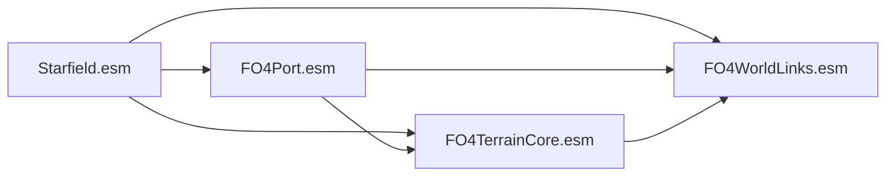

# Native core cave door: joint design

Author: Codex. Status: proposal for Claude's review; implementation has not started.
Goal: a native door trip into Red Rocket and back, with collision, facing and save/reload intact.
Claude retains the controller, producer and integration. This proposal introduces no game build or deployment.

## Evidence that constrains the design

- **Lead-reported native result:** `cave_ofst_1015` failed NOLOAD; the exterior door still reported local coordinates.
  See [the recorded result](https://github.com/fo4sf/fo4-to-starfield/issues/32#issuecomment-6208794189).
  The add-on OFST/CLSZ hypothesis is refuted for that pinned candidate. PR129 is closed with its code/evidence retained.
- **Verified on the pinned files:** source `08EB65:Fallout4.esm` is absent from core64n's scene reference map. The
  selection skips this editor marker; the visible cave mouth is a separate scene object. This needs a new native
  exterior reference, rather than an assumed existing core reference to override.
- Port's inspected `FO4Port_RedRocket01` cell has no DOOR-based or XTEL references. Check its stable map and source
  mapping before allocating: source `05E844:Fallout4.esm` might have a reservation or a flattened placement to reuse.
  Absence of a native door is not proof that no source reservation exists.
- The inspected Port header has only `Starfield.esm` as master. `Core -> Port` is therefore acyclic under this pin;
  verify the actual header again before building. Example cell local ID `002338` is an observation, not an API.
- `SliceDoor sf-door` inspection of the pinned Starfield master found 45 exterior `AutoloadDoor_Cave` references,
  all in world persistent cells, and all 345 inspected world XTEL references there too. Source FO4 endpoints are
  also persistent (`0x400`). Start with native persistence, rather than assuming a temporary door is equivalent.

These are inspection observations, not a general proof of the engine's persistence rules. The preserved
`slice_cave_ofst/evidence` JSON files identify the exact fields; their SHA256 pins are:

| Inspection output | SHA256 | Relevant JSON locations |
|---|---|---|
| `sf_autoload_door.json` | `a4024ef3da878c45b859e17c7d13864ac31e00d9ed83c672b5e57feab3b78314` | `/door`, `/refs_world_persistent_cell`, `/world_xtel_refs`, `/scale_min`, `/scale_max` |
| `port_RedRocket01.json` | `639234fdc28352f14624d28daf9cf78c1b008cda9eda93f4c5c53f212114340a` | `/masters`, `/cell`, `/door_based_refs`, `/xtel_refs` |
| `fo4_door_link.json` | `29457f1a8983bb6c962075fe3f24e45c092316bc615ab6f41074a4c45d8e9687` | `/units`, `/refs/0`, `/refs/1` |

The existing read-only `SliceDoor` commands are `fo4 <source> <output> 05E844 08EB65`,
`sf-door <source> <output> 24F9CE`, and `port <source> FO4Port_RedRocket01 <output>`;
see [Program.cs](../../dotnet/SliceDoor/Program.cs) and [Inspect.cs](../../dotnet/SliceDoor/Inspect.cs).
Core64n's map pin is `2d8551b583fbb7f5a81dfe5b480f0640918c3ca35b81273c834e90c2f1ae1e01`;
its independent output audit is recorded in [#173](https://github.com/fo4sf/fo4-to-starfield/issues/173).
The private inspection files remain outside Git. Re-pin the actual source masters before a candidate build;
these cached inspections do not establish that a later Port still has the same header or reservations.

## Recommended ownership and dependency graph

Keep each endpoint with its content plugin. Put the exterior record and outbound teleport in the core itself;
use an interior-only return patch to avoid making Port depend on Core.

| File | Responsibility |
|---|---|
| `FO4Port.esm` | Persistent native interior endpoint for source `05E844`; reuse its stable source reservation where present. It has no dependency on Core. |
| `FO4TerrainCore.esm` | Persistent native exterior endpoint for source `08EB65`, plus its XTEL to the Port endpoint. Masters include Starfield and Port. Existing scene/cave-mouth records remain. |
| Proposed `FO4WorldLinks.esm` | Return XTEL override of the Port interior endpoint, pointing to Core. Only the required interior CELL header/reference may be overridden; no exterior WRLD/CELL/reference override. |

Arrows run from a master to its dependent:

Both references use the existing native `24F9CE:Starfield.esm` / `AutoloadDoor_Cave`, with its native behavior and
properties retained. The converted cave visuals/collision remain separate. This needs no new door base record.
The telemetry bridge is a different plugin and retains its bridge-last installation rule.

The previous slice introduced add-on-owned references. It did **not** test an XTEL-only override of an existing
core-owned door, because that door was absent. Such a bridge-only alternative remains untested; it must not be
declared impossible. The recommended first implementation follows Claude's direct-core outbound-link proposal.

## Identity, master changes and publication

1. Resolve endpoints/cells as `(plugin name, local ID)` from pinned source maps. Preserve every existing scene,
   container and NAVM identity. Persist new named reservations before output; never derive door IDs from whatever
   converted last. Reuse tombstones where the same source key already owns them, with conflict validation.
2. Reserve new core door identities against **all** occupied core ranges. A later container/navmesh addition must
   preserve them or refuse before publishing; it must not silently renumber them. A persistent allocator remains
   required for general changing exports. A frozen prototype alone does not establish future save compatibility.
3. Adding Port changes core's file-local self index. Compare canonical FormKeys and typed link fields, alongside
   unchanged non-link data. Raw byte equality is insufficient across master-table changes; masking arbitrary
   differing high bytes is also insufficient. Cover NAVM/NVMI links and the Mars companion's references.
4. Pin the dependency graph, master/plugin hashes and actual installed load order. Regenerate runtime IDs and plans;
   the previous hard-coded `02/04/05` prefixes are not a contract. Reject a Port that already depends on Core.
5. Preserve record flags, source transforms/scale and intermediate source state/relationships. Any intentionally
   changed persistence/parent/base/link field needs an explicit allowed difference. Do not flatten unsupported state.
6. Prepare and validate the whole plugin/map/link-patch set before installation. Preserve recoverable publication,
   STOP/Guardian/owner-idle controls, bridge-last order and deployment exit meanings; keep old stages and saves.

## Acceptance sequence

1. **Synthetic binary gate:** fake Starfield/Port masters, two linked references, both directions resolve, no master
   cycle, exact physical parents and allowed overrides. Rebuild with another semantic object and prove old IDs stay.
   Inject map/output failures and preserve the prior generation. No game assets belong in tests or Git.
2. **Pinned offline candidate:** confirm the Port source mapping, parent-cell profile and both XTEL transforms from
   source evidence. Validate canonical identity preservation after the master change and reject unrelated overrides.
3. **Native placement gate, Claude-controlled:** fresh arrival and measured merge offset; a fresh reference read
   must place the exterior endpoint at source-local position plus that offset. Record identity, cell, loaded/disabled
   state and facing. Calibrate invisible-marker loaded-state expectations against the vanilla control. A local-only
   read cannot approve a walk/teleport result.
4. **Native trip:** walk through the engine's trigger, verify actual interior XYZ/facing against collision-derived
   floor, walk back and verify the exterior frame. No noclip or fallback teleport counts as success. Source outside
   scale is about 0.23 versus the inspected donor range 0.56..2.55: retain the controlled input initially and investigate
   trigger dimensions separately if placement passes but loading does not; never enlarge a trigger merely to pass.
5. **Save/reload:** a separate new save/campaign, leave and reload, verify position/facing and repeat the trip with
   the same pinned stack. Preserve the failed add-on campaign. No old-save or whole-map acceptance follows.

## Decisions for joint review before building

- Choose the relationship-writing path explicitly. A compiled synthetic probe of the existing
  [ReferenceLinks utility](../../dotnet/ReferenceLinks/Relationships.cs) produces one teleport/no issues for
  a local DOOR, but zero teleports/one "bases must both be doors" issue when the same typed DOOR belongs to
  a synthetic master. `IsDoor` checks only `mod.Doors`; the utility also enumerates interior cells. Its source
  blob is `dc94c7264aa2ab613a966db81d57f7532621c5a4` (identical at the design and probe heads).
  This verifies an existing utility boundary, not a failure of the proposed direct Core writer. If reusing
  that utility, it needs typed master-aware base resolution and exterior-cell support, with unknown bases
  still refused. A separate direct writer must establish those checks independently. No native master
  record was copied/overridden and no candidate was built by this probe. The command was
  `dotnet run --project <private>/RelationshipProbe.csproj -c Release --no-launch-profile`; source, output
  and SDK pins remain in the private `native-door-relationship-probe-20261016` packet.
- Confirm the three-file ownership above, or choose the smaller diagnostic where Core owns both endpoint references
  in a Port interior-cell override. The latter couples the interior endpoint's lifecycle to Core and is not the
  recommended final content ownership.
- Choose and pin the core persistent-cell profile. The inspected native shape is preferable; if changing ownership
  and cell shape together, claim only the combined result. Check COC/anchor placement before any walking.
- Agree the allocator/bootstrap and typed master-aware comparison before creating a save. Source geometry, collision,
  renderer/native physics and unrelated world records stay outside the door experiment's permitted changes.

After the slice passes, link only the already-converted interiors in reviewed batches. Keep unavailable interiors
inaccessible. Portal-gap investigation [#173](https://github.com/fo4sf/fo4-to-starfield/issues/173) and native NPC
pathfinding remain separate gates.
